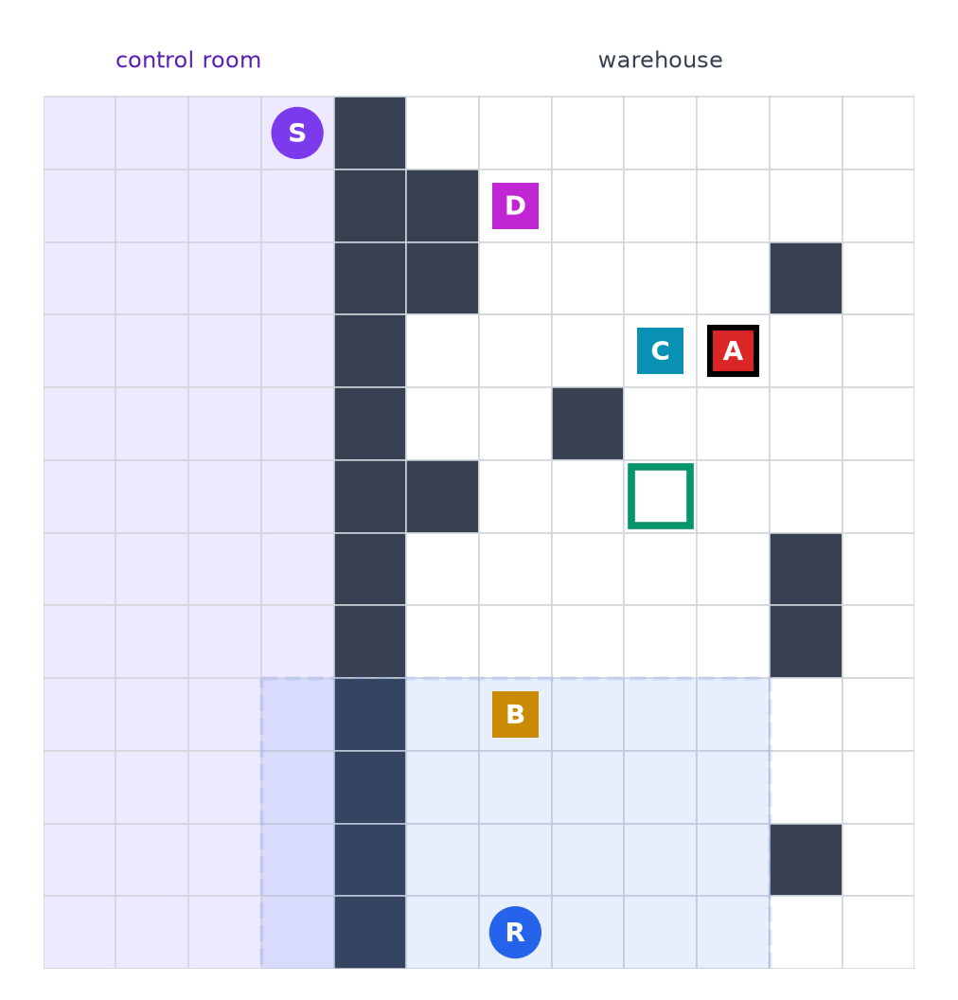
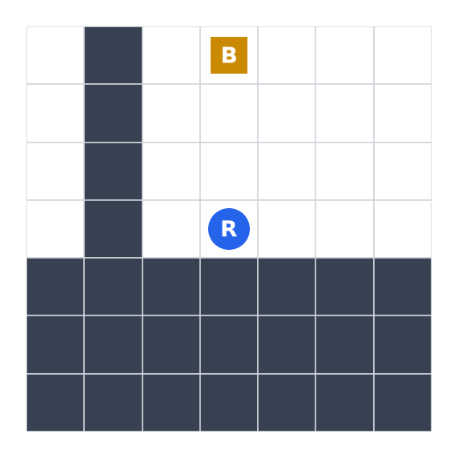
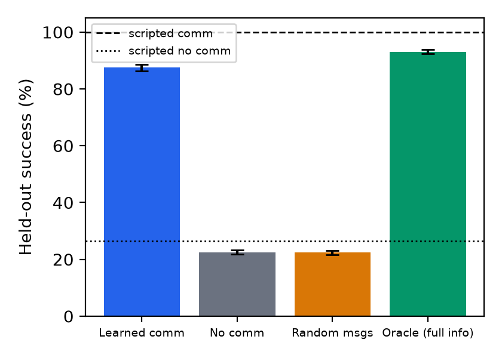
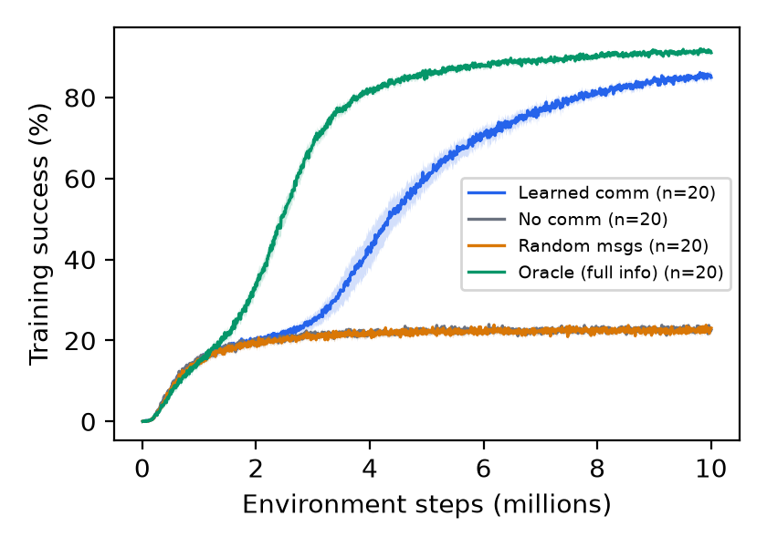
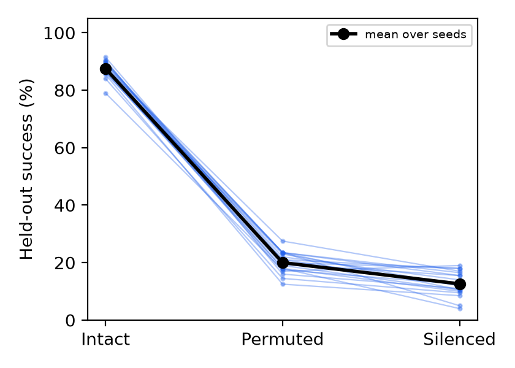
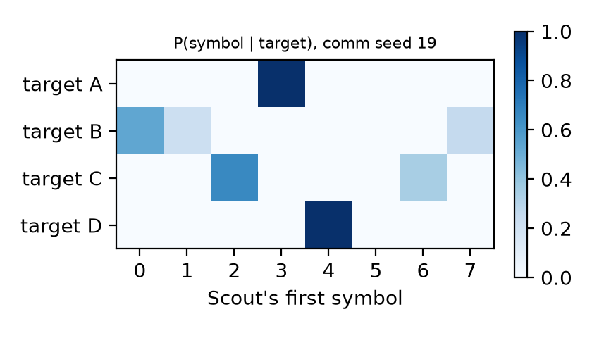
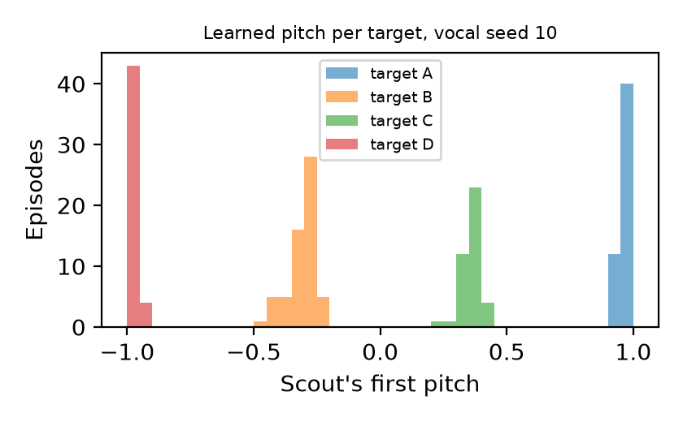
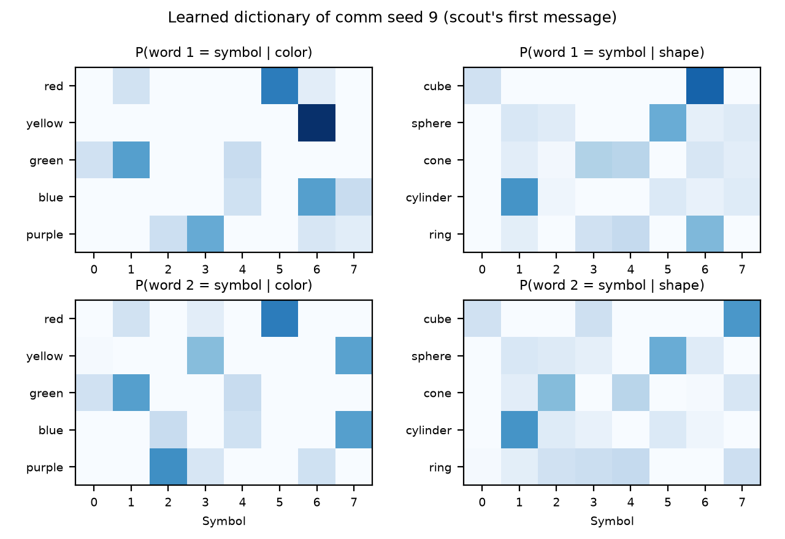

# How It Works

<p class="subtitle">A learning guide to <b>Emergent Communication in a Grid World</b><br>Christian Tadros · CAP6938 AI Knowledge Systems</p>

<div class="toc">
<p><b>What's inside</b></p>
<ol start="0">
<li>The project in one page</li>
<li>The ideas you need (no background assumed)</li>
<li>The world the agents live in</li>
<li>The code, piece by piece</li>
<li>How the experiment was run</li>
<li>Reading the results</li>
<li>The vocal channel (bonus experiment)</li>
<li>v2: words that combine</li>
<li>Try it yourself</li>
<li>Glossary</li>
<li>Questions your professor might ask</li>
</ol>
</div>

> **How to read this guide.** Part 0 is the whole story in one page. Parts 1 and 2 explain the ideas and the world without any code. Part 3 opens the hood: every file in `src/emcomm/`, what it does, and how the pieces connect. Parts 4 and 5 explain how the experiment was run and how to read each figure. Part 10 is a cheat sheet for questions. Every result number in this guide is filled in automatically from generated result files, the same sources the report uses, so the guide and the report always agree.

## 0. The project in one page

**The question.** Can two AI agents that learn on their own invent a language to coordinate, when nobody ever tells them what any word means?

**The game.** Two agents live on a 12×12 grid split by a solid wall.

- The **scout** sits in a small *control room*. It is the only one told which of four items (A, B, C, D) is wanted. It can never reach an item.
- The **runner** sits in the *warehouse* with all four items and a drop-off spot (the *depot*). It can pick up and deliver items, but it is never told which one is wanted, and it only sees a 7×7 window around itself.
- They cannot see each other. Their only connection is a radio: every step, each one sends one of 8 "symbols" (think of them as 8 different beeps), and the other hears it one step later. **The symbols start with no meaning.**
- Delivering the right item wins the round. Delivering a wrong item loses it. So a runner who just guesses wins about 1 time in 4.

**The training.** Each pair of agents practiced for {{meta.env_steps_millions}} million environment steps, receiving shared task rewards and the disclosed signalling objective. Twenty pairs were trained from scratch for each of four setups, 80 training runs in total.

**The result.** With the radio on, the agents won **{{conditions.comm.success|mpct}}** of rounds on maps they had never seen, against **{{conditions.no_comm.success|mpct}}** with the radio off. When the meaning of their symbols was secretly scrambled, success collapsed, which supports dependence on stable symbol identities. Symbol assignments were learned rather than supplied. The pre-registered success criterion from the proposal was met.

**The training choice.** A small pilot favored an auxiliary objective that makes the scout's messages informative about its cue. That is a task-specific adaptation of prior positive-signalling work, not evidence that plain IPPO can never communicate. The full-budget direct ablation is separately labeled exploratory; see Part 4.3.

## 1. The ideas you need

### 1.1 Agents, environments, and rewards

**Reinforcement learning** (RL) is learning by trial and error. There are three ingredients:

- An **environment**: the world, with rules. Here, the grid.
- An **agent**: something that looks at the world, picks an action, and repeats. Here, the scout and the runner.
- A **reward**: a number the environment hands out after each action. Here, +1 for delivering the right item.

The agent's only goal is to collect as much reward as possible. Nobody shows it the right moves. It tries things, sees what earned reward, and gradually does more of what worked.

A few words used throughout:

| Word | Meaning here |
|---|---|
| **Step** | One tick of the clock. Both agents act once (a move and a symbol). |
| **Episode** (or round, or game) | One full attempt, from the start until a delivery or until 32 steps run out. |
| **Observation** | What an agent can perceive at one step: 315 numbers (Part 2.3). |
| **Action** | What an agent does at one step: a move plus a symbol (Part 2.4). |
| **Policy** | The agent's decision rule: "given what I see and remember, how likely am I to take each action?" |

### 1.2 A policy is built from a neural network

A **neural network** is a big adjustable formula. Numbers go in (the observation), numbers come out (how likely each action is). Inside are about 158,000 adjustable numbers called **weights** for each agent. A freshly created network has random weights, so it acts randomly. **Training means adjusting the weights** until the network's choices earn reward.

The network does not output one action. It outputs a *probability* for each action ("go up 60%, go left 25%, …"), and the action is drawn at random from those probabilities. That randomness is how the agent explores.

### 1.3 How a network learns, in one paragraph

After the agents play for a while, we look at every decision they made and ask whether it turned out *better or worse than expected*. For each weight, calculus tells us which direction to change it so that better-than-expected decisions become a bit more likely and worse-than-expected ones a bit less likely. We move every weight a tiny step in that direction. This is **gradient descent**, done with an optimizer called **Adam** and a step size (**learning rate**) of 0.001. Repeat this thousands of times and the behavior improves.

### 1.4 PPO: the specific learning recipe

The project uses **PPO** (Proximal Policy Optimization), one of the most widely used RL recipes. One cycle looks like this:

<svg viewBox="0 0 640 250" xmlns="http://www.w3.org/2000/svg" font-family="Helvetica, Arial, sans-serif">
<defs><marker id="m1" markerWidth="9" markerHeight="9" refX="8" refY="4.5" orient="auto"><path d="M0,0 L9,4.5 L0,9 z" fill="#486581"/></marker></defs>
<rect x="20" y="20" width="270" height="84" rx="10" fill="#e0e8f9" stroke="#486581"/>
<text x="34" y="44" font-size="14" font-weight="bold" fill="#102a43">1. Play</text>
<text x="34" y="64" font-size="11.5" fill="#243b53"><tspan x="34">64 games at once for 128 steps = 8,192 moves,</tspan><tspan x="34" dy="16">recording what each agent saw, did, and earned</tspan></text>
<rect x="350" y="20" width="270" height="84" rx="10" fill="#e0e8f9" stroke="#486581"/>
<text x="364" y="44" font-size="14" font-weight="bold" fill="#102a43">2. Score every decision</text>
<text x="364" y="64" font-size="11.5" fill="#243b53"><tspan x="364">"Advantage": did it go better or worse</tspan><tspan x="364" dy="16">than the agent expected? (GAE)</tspan></text>
<rect x="350" y="150" width="270" height="84" rx="10" fill="#e0e8f9" stroke="#486581"/>
<text x="364" y="174" font-size="14" font-weight="bold" fill="#102a43">3. Nudge the brain</text>
<text x="364" y="194" font-size="11.5" fill="#243b53"><tspan x="364">Make good decisions more likely, bad ones</tspan><tspan x="364" dy="16">less likely, but only a little (PPO clip)</tspan></text>
<rect x="20" y="150" width="270" height="84" rx="10" fill="#e0e8f9" stroke="#486581"/>
<text x="34" y="174" font-size="14" font-weight="bold" fill="#102a43">4. Repeat</text>
<text x="34" y="194" font-size="11.5" fill="#243b53"><tspan x="34">1,221 cycles per training run</tspan><tspan x="34" dy="16">= 10 million environment steps</tspan></text>
<line x1="290" y1="62" x2="346" y2="62" stroke="#486581" stroke-width="2" marker-end="url(#m1)"/>
<line x1="485" y1="104" x2="485" y2="146" stroke="#486581" stroke-width="2" marker-end="url(#m1)"/>
<line x1="350" y1="192" x2="294" y2="192" stroke="#486581" stroke-width="2" marker-end="url(#m1)"/>
<line x1="155" y1="150" x2="155" y2="108" stroke="#486581" stroke-width="2" marker-end="url(#m1)"/>
</svg>

The three ideas inside PPO, in plain terms:

- **The value estimate.** Besides choosing actions, the network also predicts "how much reward do I expect from here?" That prediction is the *baseline*. An action is good if the result beat the baseline, bad if it fell short. The difference is the **advantage**.
- **GAE** (Generalized Advantage Estimation) is a standard way to compute advantages that blends short-term and long-term outcomes. Two settings control it: γ = 0.99 (future reward counts almost as much as immediate reward) and λ = 0.95.
- **Clipping.** PPO limits the training incentive for already-large probability-ratio changes (clip = 0.2). This encourages cautious updates; it does not impose a hard 20% bound on the final probabilities.

PPO also adds a small **entropy bonus** (0.01) that rewards keeping some randomness, so the agents keep exploring instead of locking into their first habits.

### 1.5 Memory: the GRU

The runner hears the scout's symbol and must keep acting on it for many steps while it searches the warehouse. That needs **memory**. Each agent's network contains a **GRU** (Gated Recurrent Unit): a block of 128 numbers that is updated every step from the new observation and carried forward to the next step. It is the agent's short-term memory. At the start of every new game it is wiped to zeros.

### 1.6 Two learners, each on its own

Each agent has its **own separate network** and learns only from its own experience. They share only the team reward. There is no shared brain and no central coach that sees everything. This setup is called **IPPO** (Independent PPO). It is what makes the proposal's phrase "independently learning agents" literally true: the policies learn separately from local inputs and shared task reward, with the declared cue objective added where a cue is visible.

### 1.7 Emergent communication, and why it is hard

**Emergent communication** means learned message assignments and use, rather than a programmed dictionary. This project also uses a disclosed auxiliary signalling objective. It runs into a **chicken-and-egg problem**:

- The scout gains nothing from making its symbols meaningful until the runner pays attention to them.
- The runner gains nothing from paying attention until the symbols mean something.

So at the start, neither has a reason to move first. That is exactly what happened in this project's pilot: with plain IPPO, the scout's symbols drifted into random habits that carried almost no information, the runner learned to ignore them, and success stayed at guessing level.

**The fix: a cue-informativeness bias.** The scout gets an auxiliary training objective for making its symbol choices *depend on the target it was told*. Mathematically this is the **mutual information** between its symbols and its cue: how much knowing the symbol tells you about the target (maximum 2 bits for 4 targets). This bias is a targeted version of the "positive signalling" bias from published research (Eccles et al., 2019). Crucially, it never says *which* symbol should mean *which* item, and the runner gets no supervised decoder or listener-specific loss. Symbol assignments develop under the added cue objective; the runner learns their use through task reward.

> **In plain words:** the bias tells the scout "don't mumble; say *something* different for each item." It does not tell it what to say, and it does not teach the runner anything.

## 2. The world the agents live in

### 2.1 The map


<p class="cap">A real held-out episode, drawn from the environment code. Purple: the control room with the scout (S). Dark squares: walls and obstacles. The four colored items are A–D; the target (A) has a black outline. The green square is the depot. The dashed blue box is the runner's (R) 7×7 field of view.</p>

- **Size:** 12×12 cells. Column 4 is a solid wall with no door.
- **Control room:** columns 0–3, scout only.
- **Warehouse:** columns 5–11, with the runner, the four items, the depot, and 8 obstacle cells.
- **Perception:** views are square crops, without wall occlusion. A v1/vocal scout may see nearby warehouse content across the wall; v2 masks that content explicitly. Neither agent sees the other agent's position.
- **Layouts:** 72 different obstacle arrangements were generated from a fixed seed. **48 are used for training** and **24 are held out**: the agents never see them until the final test. Testing on held-out layouts measures transfer within this layout generator; it does not rule out every kind of overfitting.

### 2.2 One episode

1. A layout is picked, and the four items, the depot, the runner, and the scout are placed at random.
2. A target item is picked at random. Only the scout's observation includes it.
3. Each step, both agents act at the same time: each picks a move and sends a symbol.
4. The episode ends when the runner delivers any item (right = success, wrong = failure) or after **32 steps** (failure).

### 2.3 What each agent observes: 315 numbers

| Block | Size | What it is |
|---|---|---|
| Local view | 294 | A 7×7 window around the agent, with 6 layers: walls (off-map counts as wall), item A, item B, item C, item D, depot. |
| Position | 2 | Its own row and column, scaled to 0–1. |
| Carrying | 5 | Nothing, A, B, C, or D (one switch on). |
| Target cue | 4 | Which item is wanted. **All zeros for the runner** (except in the oracle setup). |
| Heard symbol | 9 | The symbol it heard this step, 0–7, or "silence". |
| Time | 1 | Steps used so far, divided by 32. |


<p class="cap">What the runner actually perceives at the start of the episode above, decoded from its real observation vector. It can see item B, the wrong one, and the rows below it are off the map (shown as wall). Without a message, it has no idea that A is the target.</p>

### 2.4 What each agent can do

Every step, each agent chooses **two things at once**:

1. **A move:** stay, up, down, left, right, or *interact*. Interact picks up an item if the agent is standing on one and carrying nothing, or delivers the carried item if it is standing on the depot.
2. **A symbol:** one of 8, numbered 0–7.

Both agents have exactly the same choices. The scout's moves are mostly pointless (it can never reach an item), but keeping the action sets identical keeps the comparison clean.

### 2.5 Rewards

| Event | Reward (shared by both agents) |
|---|---|
| Every step | −0.01 (a small push to be quick) |
| Picking up any item | +0.1 |
| Delivering the target | +1, episode ends: **success** |
| Delivering a wrong item | 0, episode ends: **failure** |
| Running out of 32 steps | episode ends: **failure** |

### 2.6 The radio channel

<svg viewBox="0 0 640 150" xmlns="http://www.w3.org/2000/svg" font-family="Helvetica, Arial, sans-serif">
<defs><marker id="m2" markerWidth="9" markerHeight="9" refX="8" refY="4.5" orient="auto"><path d="M0,0 L9,4.5 L0,9 z" fill="#9f580a"/></marker></defs>
<text x="20" y="62" font-size="13" font-weight="bold" fill="#102a43">Scout says</text>
<text x="20" y="122" font-size="13" font-weight="bold" fill="#102a43">Runner hears</text>
<text x="190" y="22" font-size="12" fill="#52606d">step 0</text><text x="310" y="22" font-size="12" fill="#52606d">step 1</text><text x="430" y="22" font-size="12" fill="#52606d">step 2</text><text x="550" y="22" font-size="12" fill="#52606d">step 3</text>
<rect x="190" y="40" width="40" height="34" rx="6" fill="#be123c"/><text x="210" y="63" font-size="15" font-weight="bold" fill="#fff" text-anchor="middle">3</text>
<rect x="310" y="40" width="40" height="34" rx="6" fill="#be123c"/><text x="330" y="63" font-size="15" font-weight="bold" fill="#fff" text-anchor="middle">3</text>
<rect x="430" y="40" width="40" height="34" rx="6" fill="#be123c"/><text x="450" y="63" font-size="15" font-weight="bold" fill="#fff" text-anchor="middle">3</text>
<rect x="550" y="40" width="40" height="34" rx="6" fill="#be123c"/><text x="570" y="63" font-size="15" font-weight="bold" fill="#fff" text-anchor="middle">3</text>
<rect x="190" y="100" width="40" height="34" rx="6" fill="#d9e2ec"/><text x="210" y="123" font-size="13" fill="#52606d" text-anchor="middle">silence</text>
<rect x="310" y="100" width="40" height="34" rx="6" fill="#be123c"/><text x="330" y="123" font-size="15" font-weight="bold" fill="#fff" text-anchor="middle">3</text>
<rect x="430" y="100" width="40" height="34" rx="6" fill="#be123c"/><text x="450" y="123" font-size="15" font-weight="bold" fill="#fff" text-anchor="middle">3</text>
<rect x="550" y="100" width="40" height="34" rx="6" fill="#be123c"/><text x="570" y="123" font-size="15" font-weight="bold" fill="#fff" text-anchor="middle">3</text>
<line x1="232" y1="76" x2="306" y2="98" stroke="#9f580a" stroke-width="1.8" marker-end="url(#m2)"/>
<line x1="352" y1="76" x2="426" y2="98" stroke="#9f580a" stroke-width="1.8" marker-end="url(#m2)"/>
<line x1="472" y1="76" x2="546" y2="98" stroke="#9f580a" stroke-width="1.8" marker-end="url(#m2)"/>
</svg>

What one agent sends at step *t*, the other hears at step *t + 1*. At step 0 nobody has spoken yet, so both hear "silence". The channel runs both ways (the runner also sends symbols), but only the scout has anything useful to say.

### 2.7 Three tricks that make the test fair

1. **The scout can't do it alone.** The wall is solid, so the scout can never fetch an item itself. The target information *must* travel through the radio.
2. **No signalling by movement.** The agents' observations simply do not contain each other, so the scout can't "point" by walking somewhere. The radio is the only channel.
3. **The map can't give away the answer.** An episode is only accepted if *every* item could be delivered in time (within 20 steps by a runner who knows the target), and the target is chosen only *after* the map is accepted. If only the target had to be close, the target would usually be the nearest item, and a guessing runner could win by grabbing the closest one. With this rule the nearest item is right only 1 time in 4.

The project checked all three with a hand-written **scripted team** that plans on the true map. With a fixed codebook it succeeds {{calibration.scripted.scripted_comm|pct}} of the time; with no communication only {{calibration.scripted.scripted_no_comm|pct}}, which is chance. This supports high-success coordination with communication; an uncued runner can still guess successfully in some episodes. This scripted team is only a reference, never a competitor: it cheats by knowing the whole map.

### 2.8 Four setups and three tests

Every setup uses identical networks, settings, spaces and training length. The partial-information controls differ in radio content; the oracle also reveals the target cue:

| Setup | Runner told the target? | What the runner hears |
|---|---|---|
| **Learned comm** | no | the scout's last symbol |
| **No comm** | no | always "silence" |
| **Random messages** | no | a random symbol every step |
| **Oracle** | **yes** | always "silence" |

- **No comm** shows what guessing achieves.
- **Random messages** checks that it's *information* that helps, not just having extra input.
- **Oracle** is a learned full-information reference for navigation performance, not a mathematical upper bound.

After training, the learned-comm pairs were also tested under three conditions:

- **Intact:** normal.
- **Permuted:** in each test game, the 8 symbols are relabeled at random before the runner hears them (for example, 3 arrives as 7). If the runner reads meanings, this should destroy its success.
- **Silenced:** the runner hears nothing.

## 3. The code, piece by piece

The v1 baseline had about 1,800 lines of Python in `src/emcomm/` and 66 automated tests in `tests/`. The v2 extension adds modules and checks. Here is how the baseline pieces fit together, from settings file to report:

<svg viewBox="0 0 640 420" xmlns="http://www.w3.org/2000/svg" font-family="Helvetica, Arial, sans-serif">
<defs><marker id="m3" markerWidth="9" markerHeight="9" refX="8" refY="4.5" orient="auto"><path d="M0,0 L9,4.5 L0,9 z" fill="#486581"/></marker></defs>
<rect x="200" y="8" width="240" height="46" rx="9" fill="#f0f4f8" stroke="#486581"/>
<text x="320" y="28" font-size="13" font-weight="bold" fill="#102a43" text-anchor="middle">configs/base.toml</text>
<text x="320" y="45" font-size="11" fill="#486581" text-anchor="middle">the frozen settings</text>
<line x1="320" y1="54" x2="320" y2="76" stroke="#486581" stroke-width="2" marker-end="url(#m3)"/>
<rect x="150" y="78" width="300" height="56" rx="9" fill="#e0e8f9" stroke="#486581"/>
<text x="300" y="100" font-size="13" font-weight="bold" fill="#102a43" text-anchor="middle">sweep.py runs train.py 80 times</text>
<text x="300" y="119" font-size="11" fill="#486581" text-anchor="middle">4 setups × 20 seeds, 6 at a time</text>
<rect x="470" y="72" width="162" height="70" rx="9" fill="#fffbea" stroke="#cb6e17" stroke-dasharray="5 3"/>
<text x="551" y="93" font-size="11.5" font-weight="bold" fill="#8d2b0b" text-anchor="middle">inside train.py</text>
<text x="551" y="112" font-size="11" fill="#8d2b0b" text-anchor="middle">env · channel · layouts</text>
<text x="551" y="129" font-size="11" fill="#8d2b0b" text-anchor="middle">policy · ppo</text>
<line x1="450" y1="106" x2="468" y2="106" stroke="#cb6e17" stroke-width="1.5" stroke-dasharray="4 3"/>
<line x1="300" y1="134" x2="300" y2="166" stroke="#486581" stroke-width="2" marker-end="url(#m3)"/>
<text x="310" y="155" font-size="10.5" font-style="italic" fill="#52606d">80 trained brains: runs/…/final.pt</text>
<rect x="150" y="168" width="300" height="56" rx="9" fill="#e0e8f9" stroke="#486581"/>
<text x="300" y="190" font-size="13" font-weight="bold" fill="#102a43" text-anchor="middle">evaluate.py</text>
<text x="300" y="209" font-size="11" fill="#486581" text-anchor="middle">200 fixed test games per run, plus the tests</text>
<line x1="300" y1="224" x2="300" y2="256" stroke="#486581" stroke-width="2" marker-end="url(#m3)"/>
<text x="310" y="245" font-size="10.5" font-style="italic" fill="#52606d">results/per_run.csv</text>
<rect x="150" y="258" width="300" height="56" rx="9" fill="#e0e8f9" stroke="#486581"/>
<text x="300" y="280" font-size="13" font-weight="bold" fill="#102a43" text-anchor="middle">analysis.py + stats.py</text>
<text x="300" y="299" font-size="11" fill="#486581" text-anchor="middle">averages, 95% confidence intervals, verdict</text>
<line x1="300" y1="314" x2="300" y2="334" stroke="#486581" stroke-width="2"/>
<text x="310" y="330" font-size="10.5" font-style="italic" fill="#52606d">results/summary.json</text>
<line x1="105" y1="340" x2="535" y2="340" stroke="#486581" stroke-width="2"/>
<line x1="105" y1="340" x2="105" y2="356" stroke="#486581" stroke-width="2" marker-end="url(#m3)"/>
<line x1="320" y1="340" x2="320" y2="356" stroke="#486581" stroke-width="2" marker-end="url(#m3)"/>
<line x1="535" y1="340" x2="535" y2="356" stroke="#486581" stroke-width="2" marker-end="url(#m3)"/>
<rect x="10" y="358" width="190" height="54" rx="9" fill="#e3f9e5" stroke="#3f9142"/>
<text x="105" y="380" font-size="13" font-weight="bold" fill="#0e5814" text-anchor="middle">plots.py</text>
<text x="105" y="398" font-size="11" fill="#3f9142" text-anchor="middle">→ results/figures/</text>
<rect x="225" y="358" width="190" height="54" rx="9" fill="#e3f9e5" stroke="#3f9142"/>
<text x="320" y="380" font-size="13" font-weight="bold" fill="#0e5814" text-anchor="middle">build_report.py</text>
<text x="320" y="398" font-size="11" fill="#3f9142" text-anchor="middle">→ report/report.pdf</text>
<rect x="440" y="358" width="190" height="54" rx="9" fill="#e3f9e5" stroke="#3f9142"/>
<text x="535" y="380" font-size="13" font-weight="bold" fill="#0e5814" text-anchor="middle">replays.py</text>
<text x="535" y="398" font-size="11" fill="#3f9142" text-anchor="middle">→ viewer/ (the demo)</text>
</svg>

The code is organized in four layers. The lower layers know nothing about the upper ones.

### 3.1 Layer 1: the world (no learning)

**`config.py` (the settings).** Two frozen "dataclasses" hold every setting: `EnvConfig` (grid size 12, wall at column 4, view radius 3, 4 item types, 32-step limit, 8 symbols, rewards…) and `PPOConfig` (64 parallel games, 128-step rollouts, learning rate 0.001, the bias weight 0.2…). `load_config()` reads `configs/base.toml` and refuses unknown keys, so a typo can't silently be ignored. It also computes derived facts, such as the observation size (315) and where the target cue sits inside it.

**`layouts.py` (maps and episodes).**

- `make_layout_splits()` generates the 72 obstacle maps from a fixed seed and splits them 48/24.
- `bfs_distances()` computes the shortest walking distance from a cell to every other cell (breadth-first search), avoiding walls.
- `try_geometry()` places the items, depot, and agents and applies the fairness rule from Part 2.7: every item must be deliverable in time, and the target is drawn afterwards.
- `make_episode_set()` produces the *fixed* test games (always the same 200 for a given seed).
- `EpisodeSampler` produces an endless stream of fresh training games.

**`env.py` (the rules of the world).** `GridEnv` runs many games side by side ("vectorized") using NumPy arrays, so 64 games advance in one call. Its three main methods:

- `load(i, spec)` sets game *i* to a new episode.
- `observe(received, cue_mask)` builds the 315-number observation for both agents in every game.
- `step(moves)` applies both agents' moves, pickups, and deliveries, and returns rewards, done flags, and successes.

Everything is deterministic: the same moves always give the same outcome.

**`channel.py` (the radio).** This small file defines what each setup's radio does. Its core function, slightly simplified:

```python
def route(sent, mode, vocab_size, rng, perm=None):
    received = sent[:, ::-1].copy()      # scout hears runner, runner hears scout
    if mode == "intact":   return received
    if mode == "silenced": return all "silence" tokens
    if mode == "random":   return random symbols
    if mode == "permuted": return perm[episode, received]   # relabel symbols per episode
```

`cue_mask(condition)` says who sees the target: always the scout, and the runner only in the oracle setup.

### 3.2 Layer 2: reference agents and the test protocol

**`heuristics.py` (the scripted team).** A hand-written team used only as a reference. Its scout always sends the target's number. Its runner plans shortest paths on the true map and goes for the item the message names, or the nearest item if it has no message.

**`rollout.py` (play a fixed batch of games).** `run_episodes()` plays a list of games to the end with *any* team (scripted or learned) under any radio mode. It returns one record per game (success, steps, the scout's symbols, …) and, if asked, a step-by-step trace for the replay viewer. The training loop does not use it; it exists for testing and replays.

**`benchmark.py` (the official test).** The fixed test protocol lives here, with no learning code at all:

- `EVAL_SEED = 424242` fixes the 200 held-out test games and the 200 training-layout test games. Every run is tested on exactly the same games.
- `eval_plan(condition)` lists what each setup is tested under (comm: intact, permuted, silenced, plus training layouts).
- `summarize(records)` turns 200 game records into per-run numbers: success rate, average reward, steps, and mutual information.

**`stats.py` (statistics).** Bootstrap confidence intervals (explained in Part 4.4) and the mutual-information calculation.

### 3.3 Layer 3: learning

**`policy.py` (the brain).** `AgentNet` is each agent's network:

<svg viewBox="0 0 640 230" xmlns="http://www.w3.org/2000/svg" font-family="Helvetica, Arial, sans-serif">
<defs><marker id="m4" markerWidth="9" markerHeight="9" refX="8" refY="4.5" orient="auto"><path d="M0,0 L9,4.5 L0,9 z" fill="#486581"/></marker></defs>
<rect x="8" y="80" width="118" height="70" rx="9" fill="#f0f4f8" stroke="#486581"/>
<text x="67" y="108" font-size="13" font-weight="bold" fill="#102a43" text-anchor="middle">Observation</text>
<text x="67" y="127" font-size="11" fill="#486581" text-anchor="middle">315 numbers</text>
<line x1="126" y1="115" x2="154" y2="115" stroke="#486581" stroke-width="2" marker-end="url(#m4)"/>
<rect x="156" y="80" width="122" height="70" rx="9" fill="#e0e8f9" stroke="#486581"/>
<text x="217" y="108" font-size="13" font-weight="bold" fill="#102a43" text-anchor="middle">Encoder</text>
<text x="217" y="127" font-size="11" fill="#486581" text-anchor="middle">2 layers × 128</text>
<line x1="278" y1="115" x2="306" y2="115" stroke="#486581" stroke-width="2" marker-end="url(#m4)"/>
<rect x="308" y="80" width="122" height="70" rx="9" fill="#fff3c4" stroke="#cb6e17"/>
<text x="369" y="108" font-size="13" font-weight="bold" fill="#8d2b0b" text-anchor="middle">GRU memory</text>
<text x="369" y="127" font-size="11" fill="#8d2b0b" text-anchor="middle">128 numbers</text>
<path d="M408,80 C408,40 330,40 330,76" fill="none" stroke="#cb6e17" stroke-width="1.8" marker-end="url(#m4)"/>
<text x="369" y="34" font-size="10.5" fill="#8d2b0b" text-anchor="middle">carried to the next step</text>
<line x1="430" y1="115" x2="466" y2="46" stroke="#486581" stroke-width="2" marker-end="url(#m4)"/>
<line x1="430" y1="115" x2="466" y2="115" stroke="#486581" stroke-width="2" marker-end="url(#m4)"/>
<line x1="430" y1="115" x2="466" y2="184" stroke="#486581" stroke-width="2" marker-end="url(#m4)"/>
<rect x="468" y="20" width="166" height="52" rx="9" fill="#e3f9e5" stroke="#3f9142"/>
<text x="551" y="41" font-size="12.5" font-weight="bold" fill="#0e5814" text-anchor="middle">Move head</text>
<text x="551" y="59" font-size="10.5" fill="#3f9142" text-anchor="middle">6 choices</text>
<rect x="468" y="89" width="166" height="52" rx="9" fill="#e3f9e5" stroke="#3f9142"/>
<text x="551" y="110" font-size="12.5" font-weight="bold" fill="#0e5814" text-anchor="middle">Symbol head</text>
<text x="551" y="128" font-size="10.5" fill="#3f9142" text-anchor="middle">8 choices</text>
<rect x="468" y="158" width="166" height="52" rx="9" fill="#e3f9e5" stroke="#3f9142"/>
<text x="551" y="179" font-size="12.5" font-weight="bold" fill="#0e5814" text-anchor="middle">Value head</text>
<text x="551" y="197" font-size="10.5" fill="#3f9142" text-anchor="middle">"how well is this going?"</text>
</svg>

- `forward_sequence(obs, h0, first)` runs the network over a sequence of steps. `first` marks where a new game begins, so the memory is wiped there.
- `sample_actions()` draws a move and a symbol from the predicted probabilities and records their joint log-probability, which PPO needs later.

**`ppo.py` (the learning rule).**

- `Rollout` is a container for one batch of experience (observations, actions, rewards, values, …).
- `compute_gae()` turns rewards and value predictions into advantages (Part 1.4).
- `cue_information()` is the bias from Part 1.7: it measures, inside each batch, how much the scout's symbol choices depend on its target cue.
- `ppo_update()` is the PPO step. Its heart is three lines:

```python
ratio = (new_logp - old_logp).exp()  # how much has this choice's probability changed?
policy_loss = -min(ratio * adv, ratio.clamp(0.8, 1.2) * adv).mean()  # PPO clipping
loss = policy_loss + 0.5 * value_loss - 0.01 * entropy_bonuses - sig_coef * cue_information
```

**`train.py` (one full training run).** `train()` wires everything together: it creates 64 games, two separate networks with two separate optimizers, and the radio for the chosen setup. It then loops through 1,221 cycles of play, score, and nudge. It writes one row of progress per cycle to `metrics.csv` and saves checkpoints every 250 cycles plus `final.pt` at the end. Section 3.6 walks through one step in detail.

**`sweep.py` (many runs).** Launches the 80 training runs (4 setups × 20 seeds), 6 at a time. It is *resumable*: rerunning it skips any run that already has `final.pt`. Jobs are queued seed by seed. Parallel jobs can finish out of order; the final audit requires every planned seed and condition.

### 3.4 Layer 4: measuring and showing

- **`evaluate.py`** loads each `final.pt`, wraps the two networks in a `LearnedTeam`, and plays the fixed test games under each test condition. It writes `results/per_run.csv` (one row per run and test).
- **`analysis.py`** averages over the 20 seeds per setup, computes confidence intervals and the comparisons (comm − no comm, intact − permuted, …), checks the pre-registered success criterion, and writes `results/summary.json` and `summary.md`.
- **`plots.py`** draws the four report figures.
- **`replays.py`** records step-by-step traces of a few test games (intact, permuted, and no-comm versions of the *same* game) into `viewer/data/replays.js` for the demo viewer.
- **`viewer/`** is a self-contained web page (HTML + JavaScript, no server needed) that animates those traces and can play each heard symbol as a musical note.
- **`report/build_report.py`** fills the report template's placeholders (markers wrapped in double curly braces) with numbers from result JSON and typesets it with the pinned CVPR template. This supplementary guide uses the same data loader and a separate HTML-to-PDF renderer.

### 3.5 Gate scripts

These are small scripts in `scripts/` that check the experiment at each checkpoint:

- `calibrate.py` runs the scripted-team fairness check (Part 2.7).
- `pilot_report.py` scores the pilot runs on training layouts only.
- `check_sweep.py` confirms that all 80 runs finished with equal training budgets.

### 3.6 The life of one training step

This is what happens, in order, every step inside `train.py`. It runs 156,288 times per training run (128 steps × 1,221 cycles), and each time it advances all 64 games at once: 10 million game steps in total.

1. **Look.** `env.observe(received, mask)` builds each agent's 315 numbers in all 64 games, including the symbol each one heard.
2. **Think and act.** For each agent separately, `forward_sequence()` runs its network (updating its GRU memory), and `sample_actions()` draws a move and a symbol.
3. **The world responds.** `env.step(moves)` moves the agents and handles pickups and deliveries, returning rewards and which games just ended.
4. **The radio carries the symbols.** `route(sent, mode, …)` decides what each agent will hear next step: the partner's symbol, silence, or a random symbol, depending on the setup.
5. **Finished games restart.** Every game that just ended is replaced with a fresh one from `EpisodeSampler`. Its "heard" token is reset to silence, and the `first` flag tells the networks to wipe that game's memory.
6. **Remember.** Observations, actions, log-probabilities, values, rewards, and done flags go into the rollout buffer.

After 128 steps, the cycle ends:

- Compute advantages with GAE.
- Run `ppo_update()` for the scout and then for the runner, each on its own experience: 4 passes over the data in 4 mini-batches.
- Write a row to `metrics.csv`.

### 3.7 Seeds and exact reproducibility

Every source of randomness is pinned to a number (a **seed**):

| Seed | Controls |
|---|---|
| 20260930 | the 72 maps |
| run seed (0–19 for the experiment, 1000+ for pilots) | network starting weights, training games, action sampling |
| run seed + 1 | the random-message radio |
| 424242 (`EVAL_SEED`) | the fixed test games, test-time sampling, and permutations |

PyTorch runs single-threaded in deterministic mode. **Bitwise repeatability is checked within the recorded software boundary; it is not guaranteed across hardware or library versions.** A test checks this (`test_training_is_bitwise_reproducible`). It was also confirmed for real: the pilot rerun in the repository reproduced the prototype's learning curve to the last digit.

### 3.8 What the v1 baseline tests protect

- **The world:** walls block movement, a wrong delivery fails, the time limit works, the observation layout is correct, and replaying the same actions gives the same result.
- **Fairness:** the information-leak test (a no-information runner stays at chance) and the episode rules (every item reachable in time).
- **Learning:** GAE matches a hand calculation, the network's memory resets at episode boundaries, PPO updates change the weights, and training is bit-reproducible.
- **Statistics and reporting:** the bootstrap intervals, mutual information, the success criterion logic, the figures, and the report placeholders.
- **A regression guard** (`test_regression.py`): fixed short-run training and evaluation fingerprints that catch regressions without rerunning the whole benchmark. They do not prove every possible long-run behavior is unchanged.

## 4. How the experiment was run

### 4.1 Pre-registration: deciding before looking

Before any of the 80 real training runs started, the plan wrote down exactly what would be measured, how, and what would count as success. That plan was frozen with a git tag (`prereg-v1`). Pre-registration prevents the most common way experiments fool themselves: changing the goalposts after seeing the results. Any later change has to be logged in `docs/DEVIATIONS.md`.

**The two pre-registered hypotheses:**

- **H1:** learned comm beats no comm by at least 15 percentage points on held-out maps, and the 95% confidence interval excludes zero.
- **H2:** permuting the symbols lowers learned-comm success by at least 10 percentage points, with a 95% confidence interval that excludes zero.

The proposal's success criterion is met only if both hold.

### 4.2 Gates: go/no-go checkpoints

| Gate | What had to be true |
|---|---|
| G0 | The repository exists and installs cleanly. |
| G1 | The world is correct and fair (the scripted-team check passes). |
| G2 | A pilot shows the task is learnable and picks the frozen configuration. Then freeze. |
| G3 | All 80 runs finished with equal budgets. |
| G4 | Results computed, checked, and committed. Verdict recorded. |
| G5 | Report, figures, and demo all build from the results. |

### 4.3 The pilot and the decision rule

The pilot used separate seeds (1000–1002) and judged only on *training* layouts, so it could never peek at the real test. Two configurations ran side by side:

| Configuration | Oracle | No comm | Learned comm |
|---|---|---|---|
| Rung 0: plain IPPO | {{pilot.rung0.means.oracle|pct}} | {{pilot.rung0.means.no_comm|pct}} | {{pilot.rung0.means.comm|pct}} |
| Rung 1: + cue-informativeness bias | {{pilot.rung1.means.oracle|pct}} | {{pilot.rung1.means.no_comm|pct}} | {{pilot.rung1.means.comm|pct}} |

A decision table written *before* the pilot said: use plain IPPO if it passes; otherwise use the bias if it passes. Plain IPPO failed the small pilot's selection rule, so the bias configuration was frozen. Note that "no comm" is identical in both rows, down to the last digit. The bias only touches the scout's symbols, which nobody hears in that setup, so it cannot make the control look worse.

### Full-budget original-method ablation

A separate 20-seed comparison removes only the cue-information objective, keeping the v1 architecture, environment, optimizer and budget fixed. It was declared after the original outcomes had been seen, so it is post-hoc exploratory and does not extend the frozen hypotheses.

{{ablation.report}}

### 4.4 Statistics in plain words

Each of the 20 runs per setup gives one success rate (out of 200 test games). The reported number is the **average over the 20 runs**.

**The 95% confidence interval (CI)** says how sure we are about that average. It is computed with the **bootstrap**:

1. Pretend the 20 runs are a bag. Draw 20 runs from it *with replacement* (some get picked twice, some not at all) and compute the average.
2. Do that 10,000 times.
3. The middle 95% of those 10,000 averages is the CI.

A narrow CI means the 20 runs agree closely with each other.

- **Independent comparisons** (comm vs. no comm) resample the two setups separately, because they are different runs.
- **Paired comparisons** (intact vs. permuted) compare each run with *itself*, because it is the same trained pair tested two ways. That is more precise.

## 5. Reading the results

### 5.1 Success by setup (Figure 1)


<p class="cap">Bar height is the average success over 20 trained pairs on held-out maps; the tiny black bars are the 95% CIs. The dashed line is the scripted team with a fixed codebook; the dotted line is the scripted team guessing.</p>

- Learned comm reaches **{{conditions.comm.success|mpct}}**, close to the oracle's **{{conditions.oracle.success|mpct}}** (the runner simply told the answer).
- No comm (**{{conditions.no_comm.success|mpct}}**) and random messages (**{{conditions.random_msg.success|mpct}}**) sit at guessing level.
- **H1:** comm − no comm = **{{comparisons.comm_minus_no_comm|pp}}**. The bar was 15 points.

Why isn't learned comm at 100%? The runner still has to *find* the item in a maze it only partly sees, within 32 steps. Even the oracle, which needs no message at all, reaches only {{conditions.oracle.success|mpct}}.

### 5.2 Learning over time (Figure 2)


<p class="cap">Success during training, averaged over the 20 runs per setup (shaded band = 95% range).</p>

- All four setups first learn to deliver *some* item, which takes everyone to about 20% (guessing).
- The oracle takes off first, around 2 million steps: it only has to learn to use the cue it is given.
- Learned comm takes off later, around 3 million steps, because the pair must first *invent* the code and then learn to use it.
- No comm and random messages stay flat at guessing level for the whole run.

### 5.3 The causal test (Figure 3)


<p class="cap">Each thin line is one trained pair, tested on the same 200 held-out games three ways. The thick line is the average.</p>

- **H2:** intact − permuted = **{{comparisons.intact_minus_permuted|pp}}**. Every single pair collapses when its symbols are relabeled. This is evidence that the runner depends on stable symbol identities.
- Silenced is even worse: intact − silenced = **{{comparisons.intact_minus_silenced|pp}}**. The runners never heard silence after the first step during training, so it confuses them more than a wrong symbol does.

### 5.4 The invented dictionary (Figure 4)


<p class="cap">For one typical pair (the median seed): how often the scout's first symbol was each number (columns), for each target (rows). Dark = always.</p>

How to read it: in this pair, target A was always signalled with symbol 3, and D always with symbol 4. B and C each used a few **synonyms** (B was sometimes 0, 1, or 7), but **no symbol was ever shared between two targets**, so the runner can always decode it. Other pairs invented completely different assignments. That is what "meanings were never programmed" looks like.

### 5.5 What mutual information does and doesn't show

Mutual information (MI) measures how much the scout's first symbol tells you about the target, from 0 bits (nothing) to 2 bits (everything). It is {{conditions.comm.mi_first_msg|bits}} for learned comm, but also {{conditions.no_comm.mi_first_msg|bits}} for no comm, where nobody hears the scout at all. The bias makes every scout informative. That's why MI alone can't prove communication: it measures the *speaker*. Only the permutation test measures whether the *listener* uses the message. This is a known pitfall in emergent-communication research (Lowe et al., 2019), and the project's design handles it.

## 6. The vocal channel (bonus experiment)

This experiment was declared as *exploratory* before pre-registration. It does not count toward H1 or H2.

### 6.1 What changed

- **A voice instead of beeps.** Each agent emits a continuous "pitch" between −1 and 1 instead of one of 8 symbols. The listener hears it with random noise added (standard deviation 0.1). The network's symbol head becomes a pitch head that outputs a mean pitch, with a single learned spread, and the actual pitch is sampled from a bell curve around the mean.
- **An ear like a cochlea.** The listener hears through 8 overlapping "tuning curves" spread across the pitch range, the way the inner ear has hair cells tuned to different frequencies. Each curve responds most to pitches near its center. This keeps the signal continuous and noisy, but makes it learnable.
- **A continuous version of the bias.** It rewards the scout for making the four targets' pitches *distinct and consistent* using a Gaussian pairwise-distance information surrogate inspired by Kolchinsky and Tracey (2017). Clipping means it is not an exact bound for the actual heard channel; see the report reference.
- **A different causal test: shuffling.** Each runner hears the pitch spoken in a *different* test game. It still sounds like a scout, but no longer matches this game's target.
- **Longer training.** The vocal arm uses {{vocal.meta.env_steps_millions}} million steps per run. Its larger budget means cross-arm success rates do not isolate channel type.

### 6.2 Why the first design failed

The first version used a raw pitch number as the ear and squashed pitches with a curve that saturates at the edges. Two things went wrong:

- The scout's pitches jammed at the extremes (+1 and −1), and two targets flipped back and forth between them.
- The runner never learned to use the signal: shuffling made no difference.

The fixes were the cochlea-like ear, a pitch that does not saturate, and a bias that penalizes inconsistent notes. This redesign was done on pilot seeds, before any real vocal runs, and is documented in the spec.

### 6.3 Results


<p class="cap">For one typical vocal pair: the scout's first pitch in each held-out test game, colored by target. Four separate peaks mean the scout invented four distinct "notes".</p>

- Vocal comm reaches **{{vocal.conditions.comm.success|mpct}}** vs. **{{vocal.conditions.no_comm.success|mpct}}** without communication: a gain of {{vocal.comparisons.comm_minus_no_comm|pp}}.
- Intact − shuffled = {{vocal.comparisons.intact_minus_shuffled|pp}}: hearing another game's voice wipes out the gain, so the runner listens to the actual pitch.
- The scout split its continuous voice into four notes, roughly evenly spaced, illustrating separated pitch categories in that representative run; no optimal arrangement is established.

## 7. v2: words that combine

v2 is a second, separately pre-registered experiment (tag `prereg-v2`). v1 asked whether the agents could invent a useful code. v2 asks whether parts of a two-word message line up with parts of a meaning, and whether the learned protocol works for combinations the agents never encountered in training.

### 7.1 What changed

- **Items have two properties.** Five colors × five shapes give 25 kinds. The scout's secret is now something like “blue cone.”
- **Every episode contains look-alikes.** The four items form a 2×2 square: two colors × two shapes. On ordinary seen-square sampling, knowing only “blue” leaves two candidates, and knowing only “cone” also leaves two.

<svg viewBox="0 0 360 150" xmlns="http://www.w3.org/2000/svg" font-family="Helvetica, Arial, sans-serif" font-size="12">
  <text x="120" y="18" text-anchor="middle" fill="#334e68">cube</text>
  <text x="240" y="18" text-anchor="middle" fill="#334e68">cone</text>
  <text x="40" y="60" text-anchor="middle" fill="#334e68">blue</text>
  <text x="40" y="120" text-anchor="middle" fill="#334e68">red</text>
  <rect x="100" y="38" width="40" height="40" fill="#2563eb"/>
  <polygon points="240,36 220,80 260,80" fill="#2563eb" stroke="#102a43" stroke-width="3"/>
  <rect x="100" y="98" width="40" height="40" fill="#dc2626"/>
  <polygon points="240,96 220,140 260,140" fill="#dc2626"/>
  <text x="300" y="62" fill="#102a43">← target</text>
</svg>
<p class="cap">One episode's four items. “Blue” leaves two candidates; “cone” leaves two; “blue cone” leaves one.</p>

- **Messages have two words.** Each word is one of eight symbols, giving 64 possible messages. That is enough to give all 25 targets unrelated names, so the network is not forced to put color in one position and shape in the other.
- **Five combinations are absent from training:** {{v2.meta.held_out_combos}}. Every color and every shape still appears in other combinations.
- **The four controls remain.** Learned comm receives the scout's words; no comm receives silence; random messages receive unrelated words; and the oracle runner sees the target. Each learned condition trains for {{v2.meta.env_steps_millions}} M environment steps, with weight {{v2.meta.sig_coef}} on the sum of each word's information about the joint color–shape cue. No fixed word-to-property assignment or penalty for redundancy is supplied.
- **The tests separate maps from meanings.** `held_out` uses new layouts with seen combinations. `unseen` uses the five combinations absent from training. `train` checks familiar layouts.

### 7.2 How the new tests work

There are four message interventions for learned comm:

- **Whole-message permutation** relabels both words and tests whether the runner depends on their learned identities.
- **Word-1 and word-2 permutation** scramble one position at a time. A larger drop for one position shows where the listener is sensitive, but it does not by itself prove that the position means color or shape.
- **Silencing** removes the message on the pre-registered splits where this intervention is run.

The analysis also records color and shape accuracy among picks, and divides wrong picks into same-color, same-shape, and opposite-property twins. The scout's first messages get four further descriptions:

- mutual information between each word and each property;
- **topographic similarity**, which asks whether similar meanings have similar messages;
- **positional disentanglement**, which asks whether word positions specialize in different properties; and
- a lexicon plot showing the median seed's symbol frequencies for every color and shape.

These measurements can be consistent with a compositional code when they agree. None is a categorical proof on its own.

### 7.3 The fixed sequence

The pre-registration tests claims in the order A → B → C. If an earlier claim is not supported or cannot be estimated, later claims are not reached.

| Claim | What must happen | Result |
|---|---|---|
| A: communication works in v2 | H1: seen comm gain; H2: seen whole-message permutation drop | {{v2.report.claim_a_status}} |
| B: the language generalizes | A, then H3: unseen comm gain | {{v2.report.claim_b_status}} |
| C: unseen success above the fixed 50% reference | B, then H4: unseen success and its CI above 50% | {{v2.report.claim_c_status}} |

The corresponding estimates are H1 {{v2.comparisons.held_out.comm_minus_no_comm|pp}}, H2 {{v2.comparisons.held_out.intact_minus_permuted|pp}}, H3 {{v2.comparisons.unseen.comm_minus_no_comm|pp}}, and H4 {{v2.conditions.comm.unseen.success|ci}}. If an input is JSON `null`, the guide prints “not estimable” instead of inventing a value.

### 7.4 Reading the results

| Condition | Seen combinations | Never-seen combinations |
|---|---|---|
| Learned comm | {{v2.conditions.comm.held_out.success|ci}} | {{v2.conditions.comm.unseen.success|ci}} |
| No comm | {{v2.conditions.no_comm.held_out.success|ci}} | {{v2.conditions.no_comm.unseen.success|ci}} |
| Random messages | {{v2.conditions.random_msg.held_out.success|ci}} | {{v2.conditions.random_msg.unseen.success|ci}} |
| Oracle | {{v2.conditions.oracle.held_out.success|ci}} | {{v2.conditions.oracle.unseen.success|ci}} |

The word-specific success drops are {{v2.comparisons.held_out.intact_minus_permuted_w1|pp}} for word 1 and {{v2.comparisons.held_out.intact_minus_permuted_w2|pp}} for word 2 on seen combinations; intact − silenced is {{v2.comparisons.held_out.intact_minus_silenced|pp}}. Among the runner's seen-combination picks, color is correct {{v2.conditions.comm.held_out.color_acc|mpct}} and shape is correct {{v2.conditions.comm.held_out.shape_acc|mpct}}. These are descriptive measures and should be read with the lexicon rather than treated as a separate hypothesis.


<p class="cap">The median comm seed's learned lexicon. Compare each word's color and shape bands; an apparent alignment is descriptive evidence, not a verdict by itself.</p>

For the learned comm condition pooled across seen and unseen combinations (400 episodes per seed), topographic similarity is {{v2.conditions.comm.held_out.topsim|num2}} and positional disentanglement is {{v2.conditions.comm.held_out.posdis|num2}}. Values nearer 1 indicate stronger structure under those definitions, but neither number proves compositionality.

### 7.5 Why 50% is not an unseen ceiling

The unseen test has a special prior: its five target pairs form a one-to-one matching. A source-only enumeration, using no learned model or evaluation result, lists {{v2.support_reference.unseen_prior.equiprobable_target_square_states}} equally likely target–square states. In {{v2.support_reference.unseen_prior.held_out_candidate_count_distribution.1}} states the square contains one held-out candidate; in {{v2.support_reference.unseen_prior.held_out_candidate_count_distribution.2}} it contains two. Choosing from that support with uniform tie-breaking identifies the target before navigation at {{v2.support_reference.support_aware_no_message_identification_rate|pct}} in expectation. Knowing either property plus the matching identifies it at {{v2.support_reference.one_property_plus_matching_identification_rate|pct}}. This is a theoretical identification calculation, not learned performance or navigation success.

That is why Claim C means only “unseen success above the fixed {{v2.support_reference.fixed_h4_reference|pct}} reference.” It does not mean that both properties transferred, and it does not prove compositionality. Word interventions, the lexicon, mutual information, topographic similarity, and positional disentanglement provide descriptive context.

**Generated interpretation.** {{v2.report.interpretation}}

## 8. Try it yourself

All commands run from the project folder. `uv` manages Python and the libraries.

```bash
uv sync                      # install everything (first time only)
uv run pytest -q             # run the full test suite
open viewer/index.html       # the demo: click a tab, press Play, turn Sound on
open viewer/vocal.html       # the vocal-channel demo
uv run python scripts/calibrate.py   # rerun the fairness check (Part 2.7)
```

**Watch an agent learn (about 10 minutes).** Train one pair on a short budget, in a scratch folder that is gitignored:

```bash
uv run python -m emcomm.train --config configs/base.toml --condition comm \
    --seed 1234 --out runs/scratch/comm --total-env-steps 4005888
cut -d, -f2,4 runs/scratch/comm/metrics.csv | tail -5    # env steps, success rate
```

The success rate should creep up from near 0 to about 20% (guessing), then start rising past it around 3–4 million steps.

**Ideas to explore** (always with a copy of the config, never by editing `configs/base.toml`, which is frozen):

- Train `no_comm` with the same seed and compare the curves.
- Make a copy of the config with `sig_coef = 0.0` (no bias), to see the chicken-and-egg problem for yourself.
- Change `vocab_size` to 4 or 16 and see whether the code still forms.

## 9. Glossary

| Term | Meaning |
|---|---|
| Advantage | How much better (or worse) an action turned out than the agent expected. |
| Agent | A learner that observes, acts, and receives reward. Here: the scout and the runner. |
| Bootstrap | Resampling the runs many times to estimate how uncertain an average is. |
| Checkpoint (`.pt`) | A saved copy of the networks' weights. |
| Compositional language | A language whose message parts stand for parts of the meaning, so known parts can be combined in new ways. |
| Confidence interval (CI) | An interval estimating uncertainty; 95% describes the procedure's repeated-sample coverage. |
| Cue | The target information given to the scout. |
| Emergent communication | Message assignments and use learned without a programmed dictionary; auxiliary biases must be disclosed. |
| Entropy bonus | A small reward for keeping some randomness, so agents keep exploring. |
| Episode | One game, from start to delivery or timeout. |
| GAE | Generalized Advantage Estimation, a standard way to compute advantages. |
| GRU | A recurrent network block that gives the agent short-term memory. |
| Held-out layouts | Maps never used in training, kept for the final test. |
| IPPO | Independent PPO: each agent learns with its own separate network. |
| Mutual information (MI) | How much one thing tells you about another, in bits. |
| Oracle | A learned reference where the runner is told the target. |
| Percentage points (pp) | The difference between two percentages (for example, 80% − 30% = 50 pp). |
| Permutation test | Relabeling the symbols to check that their meaning matters. |
| Policy | The agent's decision rule, here a neural network. |
| Positional disentanglement | How much each word position specializes in one property (1 means each position encodes exactly one). |
| PPO | Proximal Policy Optimization, the learning recipe used here. |
| Pre-registration | Writing down the hypotheses and analysis before seeing the results. |
| Seed | A number controlling randomness within the recorded execution boundary. |
| Topographic similarity | How well distances between messages track distances between meanings (1 means perfectly). |
| Weights | The adjustable numbers inside a neural network. |

## 10. Questions your professor might ask

**"Did you program what the symbols mean?"**
No. Nothing in the code links any symbol to any item. The symbol assignments are learned separately in each training run. The bias only rewards the scout for saying *something different* per item; it never says what.

**"How do you know they're really communicating, not something else?"**
Three pieces of evidence:

- Their observations omit other-agent positions and the uncued runner's target cue. The scout cannot reach the items, so messages carry target information in the base task.
- Random messages provide a matched control without useful target information.
- Relabeling the symbols substantially reduces aggregate success (intact − permuted = {{comparisons.intact_minus_permuted|pp}}).

**"Isn't the bias cheating?"**
It is a disclosed design choice informed by a small train-only pilot. The scout receives a cue-information objective, while the listener learns from task reward. The direct ablation isolates this added term within the selected task and configuration. Positive signalling is prior work (Eccles et al., 2019).

**"Why isn't it 100%?"**
Learned comm reaches {{conditions.comm.success|mpct}}. The runner sees only a 7×7 window and has 32 steps. Even when told the target directly (the oracle), it reaches {{conditions.oracle.success|mpct}}. The oracle is a learned reference, not a guaranteed upper limit.

**"Why such a simple world?"**
Because the goal was a *clean causal test*. A small world makes it possible to block every other channel, test the information path needed for reliable coordination, and run 80 independent trainings with proper statistics. A 3D world or a harder task would be a natural next step.

**"What surprised you?"**
The small plain-IPPO pilot failed the selection rule, while the biased method communicated reliably in this task. That does not establish a universal necessity for the bias. Silence also reduced success more than permutation, consistent with a message-absence distribution shift.
