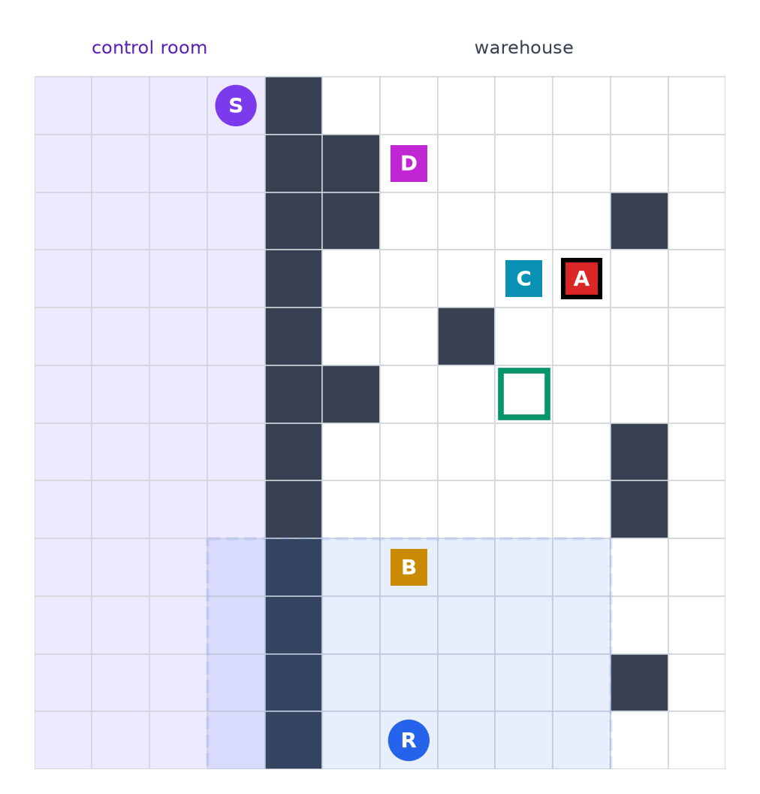
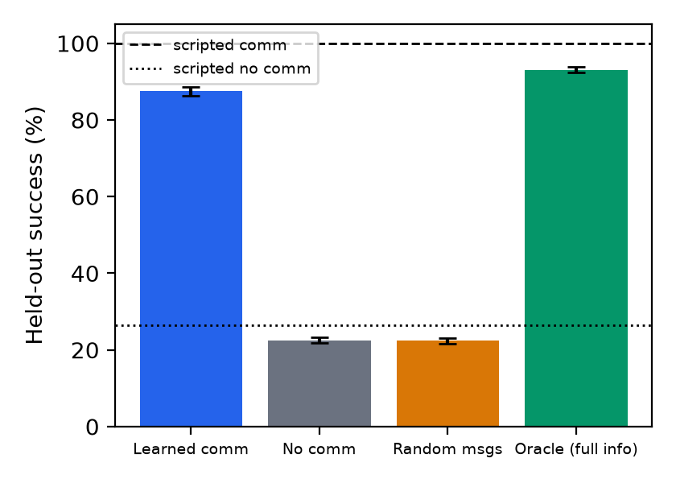
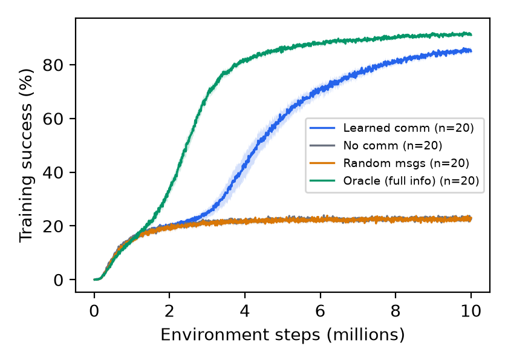
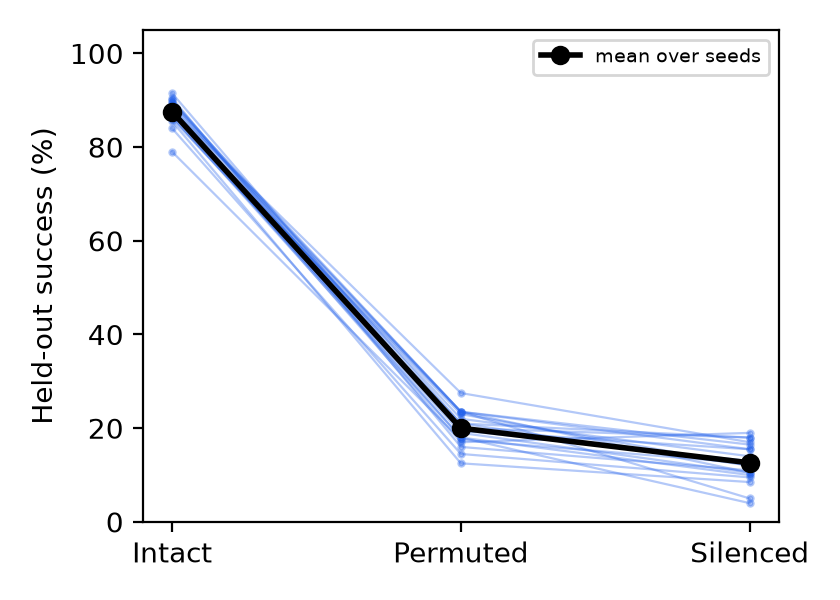
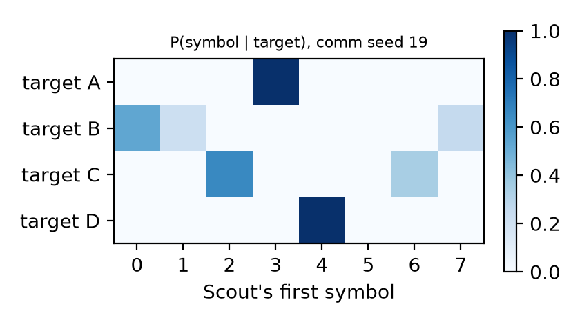
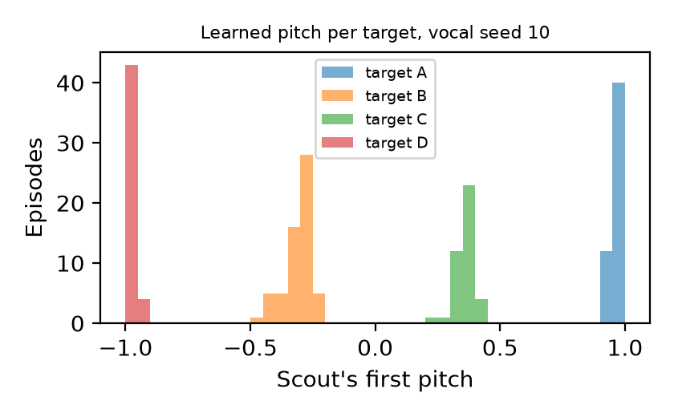
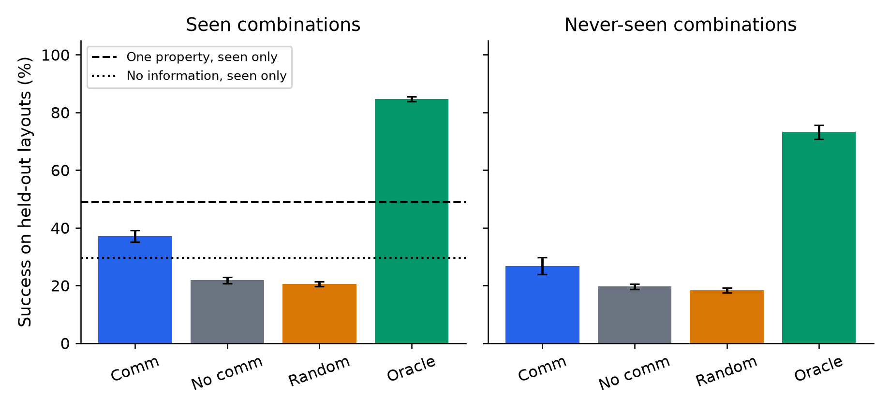
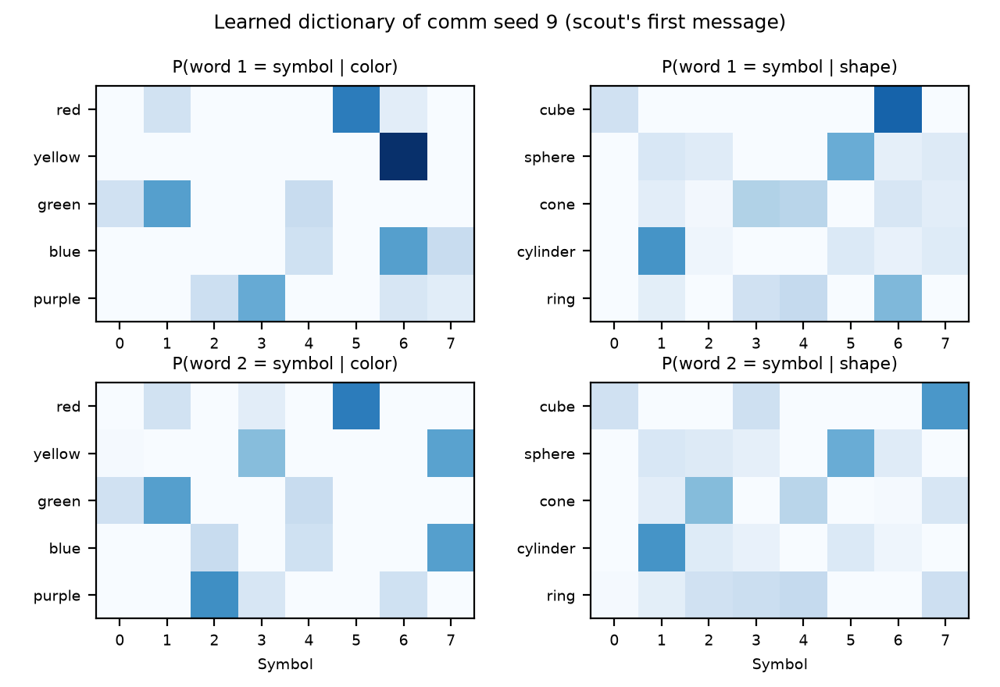

# Emergent Communication in a Grid World

Christian Tadros · CAP6938 AI Knowledge Systems · Scientific Track · November 2026

## Abstract

This project tests whether independently trained recurrent agents can learn useful message meanings in a task with complementary private information. A scout knows the target and a runner must collect it, with the target hidden from the runner and a wall blocking physical interaction. I adapt independent PPO with a cue-directed positive-signalling objective, without assigning symbols to targets or adding a listener-specific loss. Across 20 seeds per condition, discrete communication reaches {{conditions.comm.success|ci}} held-out success, with a {{comparisons.comm_minus_no_comm|pp}} advantage over no communication. A message-permutation intervention removes {{comparisons.intact_minus_permuted|pp}}, distinguishing informative speech from actual listener use. A separately pre-registered extension introduces two-word messages and color–shape targets. It supports communication on seen combinations but fails the frozen generalization criterion. A continuous vocal channel provides an exploratory comparison. The contribution is a controlled, reproducible test of a task-specific signalling modification and the limits of the resulting protocols, rather than a claim that symbolic communication or positive signalling is new.

## 1. Question

Can two independently learning agents develop and use a communication protocol that improves coordinated action when message meanings are never programmed? Two recurrent reinforcement-learning agents share a task that neither can reliably solve from its own observations. They can exchange one symbol from an 8-symbol vocabulary per step, and the symbols start out meaningless. I test whether a protocol emerges, whether it improves joint success on unseen maps, and whether the agents' behavior *causally* depends on it. A minimal, controlled environment makes the last question answerable; this is not a model of language.

### Contribution and connection to the course

The starting method is independent recurrent PPO (Schulman et al., 2017; de Witt et al., 2020). The specific modification is an auxiliary objective that makes the scout's messages informative about its private target cue. The task contribution is to direct the signalling pressure toward the missing information needed by the partner, while leaving the symbol assignment and listener policy learned. The direct ablation removes only this objective. Channel controls answer a different question: whether a trained communicating pair benefits from receiving informative messages. Keeping these comparisons separate prevents a communication advantage from being mistaken for evidence about which training component caused it.

This implements **Topic 7: AI Agents**, specifically agent reinforcement learning and multi-agent systems. Local observations define the agent's information boundary; GRU memory summarizes observation history; factorized movement and message actions couple control with communication. Separate actor–critics learn from a shared reward without a centralized critic, exposing credit assignment: a scout's message can help only through the runner's later actions. The private cue and delayed channel make coordination depend on information exchange. Permutation and silence interventions test whether that learned interface affects decisions. These are implementation choices illustrating the course's broad agent topics, not claims that the lectures prescribe this architecture.

### Relation to prior work

Foerster et al. (2016) study learned communication in multi-agent reinforcement learning, and Lazaridou et al. (2017) study coordination through emergent symbols. This project follows that research direction in an intentionally small navigation task. It does not claim to introduce emergent communication or to outperform those systems on their benchmarks.

The closest methodological antecedent is Eccles et al. (2019), who introduce positive-signalling and positive-listening biases. Their signalling objective relates messages to a speaker's trajectory. Here the statistic groups message distributions by the private target cue, a task-specific adaptation that averages over within-cue variation in the scout's position. Specifically, it subtracts the cue-frequency-weighted entropy of each cue-group mean message distribution from the entropy of the batch mean. It does not minimize every individual message distribution's entropy. In v2, each word is rewarded against the joint color–shape cue, so the objective does not enforce a property per word. I retain ordinary reward-based listener learning. Comparing against unbiased IPPO isolates the added cue-directed term; it does **not** establish that this adaptation outperforms Eccles et al.'s original full method. An equal-budget implementation of their trajectory objective would be needed for that stronger claim.

Lowe et al. (2019) show why message correlations can be misleading when listeners do not use the channel. This motivates the interventions and the explicit comparison with informative but unheard scouts. Chaabouni et al. (2020) distinguish structural compositionality from generalization to new combinations. The second experiment follows that distinction: task transfer, property-level structure and intervention sensitivity are measured separately, and none alone licenses a language-like compositionality claim.

## 2. Environment and information structure

The world is a deterministic, seeded 12×12 grid split by a solid wall.

- **The scout** sits in a control room. It is the only agent told which of four item types (A–D) is wanted, but it can never reach an item.
- **The runner** sits in the warehouse with all four items, the depot, and 8 obstacles. It sees a 7×7 egocentric window but never sees the target.
- **Dynamics:** each step, each agent moves (or interacts) and emits a symbol, which the partner hears one step later. Picking up an item earns +0.1 and each step costs −0.01. Delivering the target earns +1 and ends the episode. Delivering a wrong item also ends it, as a failure, so guessing succeeds at most 1/4 of the time.
- **Episode sampling:** an episode is accepted only if *every* item is deliverable in time, and the target is drawn afterwards. This keeps the geometry from revealing the target.
- **Information path:** other-agent positions are absent from observations, and the uncued runner's target block is zero. The scout cannot reach items. Messages provide the target-information path in this base task.
- **Layouts:** 48 are used for training; 24 held-out layouts are used only for evaluation.

Perception is a square crop rather than line-of-sight vision. A v1 or vocal scout near the wall can see warehouse cells across it; the wall blocks movement. V2 explicitly masks the scout's warehouse content. This distinction does not reveal the private cue or scout position to the uncued runner, but limits claims about visual separation.

A scripted team with privileged map knowledge confirms that the task can be solved reliably with communication, while the no-message reference remains near guessing. On held-out layouts it succeeds {{calibration.scripted.scripted_comm|pct}} of the time with a fixed codebook and {{calibration.scripted.scripted_oracle|pct}} with the runner told the target. With no communication it succeeds {{calibration.scripted.scripted_no_comm|pct}} of the time, and with random symbols {{calibration.scripted.scripted_random_msg|pct}}.

<em class="cap">Figure 1. The partition separates private target knowledge from the warehouse. This schematic explains the observation design; it is not an evaluation outcome.</em>

## 3. Conditions and controls

All four learned conditions share the observation space (315 features), the action space (6 moves × 8 symbols), the architecture, the hyperparameters, and the training budget. The three partial-information controls differ in delivered message content; the oracle additionally reveals the target to the runner:

| Condition | Runner sees target | What the runner hears |
|---|---|---|
| Learned comm | no | the scout's last symbol |
| No comm | no | always "silence" |
| Random messages | no | a uniformly random symbol |
| Oracle (reference) | yes | always "silence" |

The random-message control separates *information* from mere extra input variability. The oracle provides a learned navigation reference with target knowledge. At evaluation time the comm runs are also tested with their symbols **permuted**: each episode applies its own random relabeling of the 8 symbols. They are also tested **silenced**. If the runner relies on what particular symbols mean, both interventions should push success toward chance.

## 4. Method

Each agent is its own actor-critic network (independent PPO):

- Architecture: a two-layer MLP, then a GRU with 128 units, then heads for the move, the symbol, and the value.
- No shared parameters and no centralized critic.
- The move and the symbol are sampled jointly and trained with the same PPO objective.
- Training ran on 64 parallel environments, with 128-step rollouts and learning rate 1e-3, for {{meta.env_steps_millions}} M environment steps per run.{{meta.signal_note}}

### The single changed component

For cued samples in a minibatch, let $q_i(m)$ be the agent's predicted message distribution, $c_i$ its private cue, $\bar q_c(m)$ the mean distribution for cue $c$, and $\bar q(m)$ the overall mean. The objective estimates cue information as

$$\widehat I(M;C)=H(\bar q)-\sum_c \widehat p(c)H(\bar q_c).$$

The added loss is $-\lambda\widehat I(M;C)$, with the frozen coefficient $\lambda={{meta.sig_coef}}$. Entropies in the training objective use natural logarithms; the reported descriptive MI uses bits. An agent with no visible cue contributes zero. This rewards different distributions across cues without choosing the symbol associated with any cue. In particular, the objective receives private cue categories but no correct-message labels. It is a deliberate inductive bias, so the result should not be described as communication emerging without any structural guidance.

Ordinary PPO uses clipped policy updates, a local value loss, generalized advantage estimation and entropy bonuses. Movement and message log probabilities are summed for the joint action. Recurrent training uses truncated backpropagation through the rollout, resetting state at episode boundaries. Both agents have separate parameters and optimizers. The listener receives no gradient through the channel and no supervised decoder target.

| Frozen optimization setting | Value |
|---|---|
| Discount / GAE coefficient | {{meta.gamma}} / {{meta.gae_lambda}} |
| PPO clipping / gradient clipping | {{meta.clip}} / {{meta.max_grad_norm}} |
| Epochs / environment minibatches | {{meta.epochs}} / {{meta.n_minibatches}} |
| Value-loss coefficient | {{meta.vf_coef}} |
| Move / message entropy coefficients | {{meta.ent_move}} / {{meta.ent_msg}} |

Each condition was trained with 20 independent seeds, for 80 runs in total. Evaluation:

- Every run was evaluated on the same 200 held-out-layout episodes, with stochastic policies and a fixed evaluation seed.
- Every run was also evaluated on 200 training-layout episodes, which gives the generalization gap.
- 95% confidence intervals use a percentile bootstrap over seeds (10,000 resamples). Between-condition differences resample the two conditions independently. Interventions and gaps are paired within a run.

The hypotheses were pre-registered before any benchmark seed was trained:

- **H1:** the comm − no-comm gain is at least 15 pp, with a CI that excludes 0.
- **H2:** the intact − permuted drop is at least 10 pp, with a CI that excludes 0.

The independent unit is a trained seed, not an evaluation episode. The repeated episodes estimate a particular policy's performance; the seed bootstrap represents training variability. These intervals are conditional on the fixed 200 scenarios per split: they do not resample tasks, map generators or hold-out matchings. Evaluation is stochastic under the same fixed generator seed, and every reported checkpoint is the final one. Held-out outcomes never select a checkpoint, pilot setting or training budget.

## 5. Results

| Condition | Held-out success | Train-layout success | Steps / success |
|---|---|---|---|
| Learned comm | {{conditions.comm.success|ci}} | {{conditions.comm.train_success|ci}} | {{conditions.comm.steps_success|num}} |
| No comm | {{conditions.no_comm.success|ci}} | {{conditions.no_comm.train_success|ci}} | {{conditions.no_comm.steps_success|num}} |
| Random messages | {{conditions.random_msg.success|ci}} | {{conditions.random_msg.train_success|ci}} | {{conditions.random_msg.steps_success|num}} |
| Oracle | {{conditions.oracle.success|ci}} | {{conditions.oracle.train_success|ci}} | {{conditions.oracle.steps_success|num}} |

<em class="cap">Figure 2. Held-out success (mean over 20 seeds, 95% bootstrap CI). Dashed and dotted lines: scripted comm and no-comm references.</em>

- **H1 (gain):** comm − no comm = {{comparisons.comm_minus_no_comm|pp}}.
- **H2 (causal):** intact − permuted = {{comparisons.intact_minus_permuted|pp}}; intact − silenced = {{comparisons.intact_minus_silenced|pp}}.
- **Control:** comm − random messages = {{comparisons.comm_minus_random_msg|pp}}.
- **Generalization gap** (train − held-out) for comm: {{conditions.comm.generalization_gap|pp}}. The negative gap also occurs for the oracle ({{conditions.oracle.generalization_gap|pp}}), consistent with an easier held-out episode set. This fixed comparison does not establish robustness to other map distributions or exclude overfitting more generally.
- **Pre-registered criterion met:** {{criterion.met}}.

<em class="cap">Figure 3. Training-episode success over environment steps (mean ± 95% band over seeds).</em>

<em class="cap">Figure 4. Each line is one comm seed evaluated on the same held-out episodes with intact, permuted, and silenced messages.</em>

Silencing the channel lowers success even further than permuting it ({{comparisons.intact_minus_silenced|pp}} vs {{comparisons.intact_minus_permuted|pp}}), consistent with a runner that always heard a symbol during training being thrown off by an out-of-distribution "silence" input.

## 6. What the symbols mean

Mutual information between the target and the scout's first symbol is {{conditions.comm.mi_first_msg|bits}} for learned comm (the maximum is 2 bits). For comparison, it is {{conditions.no_comm.mi_first_msg|bits}} for no-comm scouts, whose symbols nobody hears, and {{conditions.random_msg.mi_first_msg|bits}} for random-message scouts. MI describes the *speaker* only: a scout can be informative while the runner ignores it. That is why the permutation test, not MI, carries the causal claim (Lowe et al., 2019).

<em class="cap">Figure 5. P(first symbol | target) for the median comm seed.</em>

Figure 5 shows that some targets are expressed with more than one symbol (synonyms), while no symbol is shared between targets.

## 7. Discussion

Stable symbol identities support coordination on held-out maps: random inputs do not reproduce the gain, and scrambling removes it. The bias encourages cue-dependent messages without prescribing their assignment; shared reward trains the listener. This supports a useful task-specific protocol, not natural language or a universal communication method.

### Original-method comparison

The original train-only pilots compared three seeds per setting, giving unbiased comm {{pilot.rung0.means.comm|pct}} and biased comm {{pilot.rung1.means.comm|pct}}. These were selection evidence, not a 20-seed test of the method modification. To address that limitation, a supplementary full-budget comparison was declared on November 9 after the original outcomes were known. It retains the architecture, task, PPO settings and benchmark seeds and changes only the signalling coefficient to zero. It is post-hoc exploratory evidence; the original pre-registered claims are unchanged.

{{ablation.report}}

### What failures and interventions establish

An intervention changes the receiver's information while retaining the learned networks, layouts and target tasks. A drop under a fresh symbol permutation supports reliance on stable message identities. It does not show that a message has a human-like semantic interpretation: a learned joint controller can use arbitrary codes, repeated signals or history-dependent conventions. Silence is additionally outside the communicating listener's usual input distribution, so it is a useful ablation but a less specific test of symbol meaning.

Conditional property measures below exclude episodes without a pick, so they are not overall task accuracy. The median-seed demonstration illustrates outcomes; it is not an independent sample or a substitute for aggregate performance.

## 8. Exploratory extension: a vocal channel

This arm was declared before pre-registration but is exploratory: it does not bear on H1 or H2.

**Setup.**

- Instead of a symbol, each agent emits a continuous "pitch" in [−1, 1] and hears the other's pitch one step later with Gaussian noise (σ = 0.1).
- Task dynamics are retained. A Gaussian pairwise-distance information surrogate, inspired by Kolchinsky and Tracey (2017), replaces the discrete bias. Because the actual pitches are clipped, it is not claimed as an exact bound for the heard channel.
- 20 seeds each of vocal comm and vocal no comm were trained and evaluated on the same held-out episodes.
- The vocal budget is {{vocal.meta.env_steps_millions}} M steps per run, longer than v1; absolute rates across arms therefore do not isolate channel type.
- **The causal test is shuffling:** the runner hears the pitch the scout produced in a *different* episode. That keeps the sounds realistic but breaks their link to this episode's target.

**Results.**

- **Held-out success:** vocal comm {{vocal.conditions.comm.success|ci}} vs. vocal no comm {{vocal.conditions.no_comm.success|ci}}; the gain is {{vocal.comparisons.comm_minus_no_comm|pp}}.
- **Causal:** intact − shuffled = {{vocal.comparisons.intact_minus_shuffled|pp}}; intact − silenced = {{vocal.comparisons.intact_minus_silenced|pp}}.
- **Binned MI** (target; first pitch, 8 bins): {{vocal.conditions.comm.mi_first_msg|bits}}.

<em class="cap">Figure 6. The scout's first pitch in each held-out episode, by target, for the median vocal seed. Separate peaks mean the agents invented distinct "notes".</em>

Figure 6 shows four sharply separated notes, roughly evenly spaced across the pitch range: the agents carved the continuous, noisy voice into four categories, one per target. Hearing another episode's voice removes the gain ({{vocal.comparisons.intact_minus_shuffled|pp}}), so the runner relies on the pitch it actually hears rather than on the mere presence of sound. Vocal communication succeeds less often than discrete symbols ({{vocal.conditions.comm.success|ci}} vs {{conditions.comm.success|ci}}) even with twice the training budget, and its training curve was still rising at the end, consistent with the harder job of decoding a noisy continuous signal.

## 9. v2: words that combine

v2 is a second, separately pre-registered experiment (tag `prereg-v2`). It asks whether a learned message develops parts that track a target's color and shape, and whether the protocol works on color–shape combinations absent from training. The confirmatory claims concern task success and intervention effects. The lexicon, per-property measures, topographic similarity, and positional disentanglement are descriptive evidence about the code's structure.

**Design and conditions.** Each episode contains the four cells of a 2×2 square made from two colors and two shapes. There are five values of each property, for 25 item kinds. The five training hold-outs are {{v2.meta.held_out_combos}}; every color and shape still occurs in other training combinations. The scout emits two words per step, each drawn from eight symbols. The 64 possible messages can encode the 25 kinds holistically, so the architecture does not force one word to mean color and the other shape.

The learned-comm, no-comm, random-message, and oracle conditions retain the v1 controls. All use 64 parallel environments, 128-step rollouts, independent PPO, and {{v2.meta.env_steps_millions}} M environment steps per run. The cue objective sums each word position's information about the joint color–shape cue (weight {{v2.meta.sig_coef}}), without assigning properties to positions or penalizing redundant encoding. Evaluation uses held-out layouts with seen combinations, an `unseen` split containing only the five held-out combinations, and training layouts. The comm checkpoints also undergo whole-message permutation, word-1 permutation, word-2 permutation, and silencing where pre-registered.

The scripted references confirm the intended information structure on seen combinations: a color-only runner reaches {{v2.calibration.scripted.held_out.scripted_color_only|pct}}, a shape-only runner reaches {{v2.calibration.scripted.held_out.scripted_shape_only|pct}}, no communication reaches {{v2.calibration.scripted.held_out.scripted_no_comm|pct}}, and the full code reaches {{v2.calibration.scripted.held_out.scripted_comm|pct}}. These references use privileged navigation and are headroom checks, not learned baselines.

**Fixed-sequence hypotheses and claims.** Claims are evaluated A → B → C. A later claim is reached only when every earlier claim is supported.

| Test | Estimate | Pre-registered rule | Status |
|---|---|---|---|
| H1 | comm − no comm, seen: {{v2.comparisons.held_out.comm_minus_no_comm|pp}} | mean ≥ 15 pp; CI lower bound > 0 | {{v2.report.h1_status}} |
| H2 | intact − permuted, seen: {{v2.comparisons.held_out.intact_minus_permuted|pp}} | mean ≥ 10 pp; CI lower bound > 0 | {{v2.report.h2_status}} |
| H3 | comm − no comm, unseen: {{v2.comparisons.unseen.comm_minus_no_comm|pp}} | mean ≥ 15 pp; CI lower bound > 0 | {{v2.report.h3_status}} |
| H4 | intact comm success, unseen: {{v2.conditions.comm.unseen.success|ci}} | mean and CI lower bound > {{v2.support_reference.fixed_h4_reference|pct}} | {{v2.report.h4_status}} |

- **Claim A, communication works in v2:** {{v2.report.claim_a_status}}.
- **Claim B, the language generalizes:** {{v2.report.claim_b_status}}.
- **Claim C, unseen success above the fixed 50% reference:** {{v2.report.claim_c_status}}.

**Results** (held-out layouts; 20 seeds per learned condition; 95% bootstrap CIs):

| Condition | Seen combinations | Never-seen combinations |
|---|---|---|
| Learned comm | {{v2.conditions.comm.held_out.success|ci}} | {{v2.conditions.comm.unseen.success|ci}} |
| No comm | {{v2.conditions.no_comm.held_out.success|ci}} | {{v2.conditions.no_comm.unseen.success|ci}} |
| Random messages | {{v2.conditions.random_msg.held_out.success|ci}} | {{v2.conditions.random_msg.unseen.success|ci}} |
| Oracle | {{v2.conditions.oracle.held_out.success|ci}} | {{v2.conditions.oracle.unseen.success|ci}} |

<em class="cap">Figure 7. Success on seen and never-seen color–shape combinations. Scripted reference lines apply only to the seen panel; no unseen reference or ceiling is implied. Error bars bootstrap training seeds.</em>

**Interventions and property-level behavior.** Whole-message permutation tests whether the listener depends on the learned message identities. The word-specific interventions localize sensitivity but do not, by themselves, assign a property meaning to a word.

| Measure | Seen combinations | Never-seen combinations |
|---|---|---|
| Intact − permuted | {{v2.comparisons.held_out.intact_minus_permuted|pp}} | {{v2.comparisons.unseen.intact_minus_permuted|pp}} |
| Intact − word 1 permuted | {{v2.comparisons.held_out.intact_minus_permuted_w1|pp}} | {{v2.comparisons.unseen.intact_minus_permuted_w1|pp}} |
| Intact − word 2 permuted | {{v2.comparisons.held_out.intact_minus_permuted_w2|pp}} | {{v2.comparisons.unseen.intact_minus_permuted_w2|pp}} |
| Intact − silenced | {{v2.comparisons.held_out.intact_minus_silenced|pp}} | not run by the pre-registered plan |
| Color correct among picks | {{v2.conditions.comm.held_out.color_acc|ci}} | {{v2.conditions.comm.unseen.color_acc|ci}} |
| Shape correct among picks | {{v2.conditions.comm.held_out.shape_acc|ci}} | {{v2.conditions.comm.unseen.shape_acc|ci}} |
| Wrong picks retaining color only | {{v2.conditions.comm.held_out.twin_color|ci}} | {{v2.conditions.comm.unseen.twin_color|ci}} |
| Wrong picks retaining shape only | {{v2.conditions.comm.held_out.twin_shape|ci}} | {{v2.conditions.comm.unseen.twin_shape|ci}} |
| Wrong picks retaining neither | {{v2.conditions.comm.held_out.twin_opposite|ci}} | {{v2.conditions.comm.unseen.twin_opposite|ci}} |

**Lexicon and structural metrics.** Figure 8 shows the median comm seed's first-message symbol frequencies. Word-MI estimates use 200 seen episodes per seed; structural measures pool 200 seen and 200 unseen episodes per seed. All entries average seed-level estimates; they are consistent with compositional organization when the patterns agree, but they are not categorical proof of compositionality.

| Descriptive measure (evaluation pool) | Mean |
|---|---|
| Word 1 MI with color (seen) | {{v2.conditions.comm.held_out.mi_w1_color|bits}} |
| Word 1 MI with shape (seen) | {{v2.conditions.comm.held_out.mi_w1_shape|bits}} |
| Word 2 MI with color (seen) | {{v2.conditions.comm.held_out.mi_w2_color|bits}} |
| Word 2 MI with shape (seen) | {{v2.conditions.comm.held_out.mi_w2_shape|bits}} |
| Topographic similarity (seen + unseen) | {{v2.conditions.comm.held_out.topsim|num2}} |
| Positional disentanglement (seen + unseen) | {{v2.conditions.comm.held_out.posdis|num2}} |

<em class="cap">Figure 8. First-message symbol frequencies by target color and shape for the median comm seed. Any word–property alignment is descriptive and must be read together with the intervention and accuracy results.</em>

**Unseen-support limitation.** The unseen target prior differs from ordinary seen-square sampling. The five held-out pairs form a one-to-one matching. A source-only exhaustive enumeration finds {{v2.support_reference.unseen_prior.equiprobable_target_square_states}} equally likely target–square states: {{v2.support_reference.unseen_prior.held_out_candidate_count_distribution.1}} contain one held-out candidate and {{v2.support_reference.unseen_prior.held_out_candidate_count_distribution.2}} contain two. A strategy that knows only this support identifies the target before navigation at {{v2.support_reference.support_aware_no_message_identification_rate|pct}} in expectation; knowing either property plus the matching identifies it at {{v2.support_reference.one_property_plus_matching_identification_rate|pct}}. This is a theoretical identification calculation, not learned performance or navigation success. Therefore H4 is exclusively a test of unseen success above the fixed {{v2.support_reference.fixed_h4_reference|pct}} reference. It is not an unseen one-property ceiling and does not establish transfer of both properties or compositionality.

**Interpretation.** {{v2.report.interpretation}} Passing the seen rule requires a point gain of at least 15 pp and a CI excluding zero; it does not establish a 95% lower bound of 15 pp.

**Post-hoc failure audit.** After inspecting these results, I partitioned the existing intact comm and silenced oracle evaluations into four mutually exclusive outcomes (20 seeds, 200 episodes/split). The table shows seed means; hashed source records, all counts and seed-bootstrap intervals are retained in `results/report_diagnostics`.

| Model / split | No pickup | Wrong pickup | Correct pickup, no delivery |
|---|---|---|---|
| Comm / seen | {{diagnostics.conditions.comm.held_out.no_pick|mpct}} | {{diagnostics.conditions.comm.held_out.wrong_pick|mpct}} | {{diagnostics.conditions.comm.held_out.correct_pick_no_delivery|mpct}} |
| Comm / unseen | {{diagnostics.conditions.comm.unseen.no_pick|mpct}} | {{diagnostics.conditions.comm.unseen.wrong_pick|mpct}} | {{diagnostics.conditions.comm.unseen.correct_pick_no_delivery|mpct}} |
| Oracle / seen | {{diagnostics.conditions.oracle.held_out.no_pick|mpct}} | {{diagnostics.conditions.oracle.held_out.wrong_pick|mpct}} | {{diagnostics.conditions.oracle.held_out.correct_pick_no_delivery|mpct}} |
| Oracle / unseen | {{diagnostics.conditions.oracle.unseen.no_pick|mpct}} | {{diagnostics.conditions.oracle.unseen.wrong_pick|mpct}} | {{diagnostics.conditions.oracle.unseen.correct_pick_no_delivery|mpct}} |

The remainder is successful delivery. Correct-target pickup without delivery directly identifies post-pick navigation/time failures; no pickup mixes causes, and wrong pickup does not isolate a language error. The oracle also loses success on unseen cases, so the comm drop cannot be attributed solely to composition. This retrospective description adds no training, selection or confirmatory claim.

## 10. Limitations

- **Toy scale:** one small world, one message per step, a single-step channel delay.
- **Plug-in MI:** finite-sample bias affects the 200-episode estimates. No universal bias correction is assumed; MI remains descriptive and interventions carry the message-use claim.
- **Privileged heuristic:** the scripted reference plans on the true map, so it is a headroom check and not a baseline.
- **Tuning:** pilot tuning (configurations in the reproducibility section) used separate seeds and training layouts only. Any tuning choice still conditions the result on that configuration.
- **v2 scale:** two properties with five values each, one fixed hold-out matching of five combinations, and one learning setup. Compositional generalization may behave differently with more properties, values, or hold-out structures.
- **Method novelty and attribution:** cue-directed signalling is a task-specific adaptation of an existing information objective. The baseline ablation tests its value relative to unbiased IPPO in this task; it does not establish superiority to the full Eccles method or a new state of the art.
- **Unequal extension budgets:** the vocal and compositional extensions use longer training than v1. Their absolute success rates are descriptive cross-task comparisons, not isolated tests of channel type or compositional difficulty.

## 11. Reproducibility

The source, locked environment, per-seed tables, summaries, preregistrations (`prereg-v1`, `prereg-v2`), deviations and viewers are included. Train-only pilot selection used seeds 1000–1002 for v1 and 2000–2002 for v2. The fixed decision tables selected biased v1 and v2 rung 1 before benchmark training. The guide retains the pilot table; these small selection studies are not benchmark evidence.
Deterministic CPU operations and seeded generators are enforced, and v1 weight/evaluation golden regressions remain intact. Bitwise agreement across hardware or library versions is not assumed. The vocal arm was declared exploratory before v1 pre-registration; the added original-method ablation is post-hoc. Neither expands the original confirmatory claims.

Static viewers play saved trajectories. Fresh inference loads included final checkpoints and recomputes actions for a representative demo; it does not retrain. Complete run archives are separate. Proposed interpreter/stacking work is not part of these completed experiments.

**AI assistance disclosure.** Claude and OpenAI ChatGPT/Codex assisted with planning, implementation, checks and refinement of this existing report, including November 9 submission preparation and the exploratory ablation. See `docs/AI_ASSISTANCE.md`. The author remains responsible for the work. The accompanying video uses the author's recorded narration.

**References.**

- Jakob Foerster, Yannis Assael, Nando de Freitas, and Shimon Whiteson. [*Learning to Communicate with Deep Multi-Agent Reinforcement Learning*](https://arxiv.org/abs/1605.06676). NeurIPS, 2016.
- Angeliki Lazaridou, Alexander Peysakhovich, and Marco Baroni. [*Multi-Agent Cooperation and the Emergence of (Natural) Language*](https://arxiv.org/abs/1612.07182). ICLR, 2017.
- Ryan Lowe, Jakob Foerster, Y-Lan Boureau, Joelle Pineau, and Yann Dauphin. [*On the Pitfalls of Measuring Emergent Communication*](https://ifaamas.org/Proceedings/aamas2019/pdfs/p693.pdf). AAMAS, pages 693–701, 2019.
- Tom Eccles, Yoram Bachrach, Guy Lever, Angeliki Lazaridou, and Thore Graepel. [*Biases for Emergent Communication in Multi-agent Reinforcement Learning*](https://arxiv.org/abs/1912.05676). NeurIPS, 2019.
- Christian Schroeder de Witt, Tarun Gupta, Denys Makoviichuk, Viktor Makoviychuk, Philip Torr, Mingfei Sun, and Shimon Whiteson. [*Is Independent Learning All You Need in the StarCraft Multi-Agent Challenge?*](https://arxiv.org/abs/2011.09533). arXiv:2011.09533, 2020.
- John Schulman, Filip Wolski, Prafulla Dhariwal, Alec Radford, and Oleg Klimov. [*Proximal Policy Optimization Algorithms*](https://arxiv.org/abs/1707.06347). arXiv:1707.06347, 2017.
- Rahma Chaabouni, Eugene Kharitonov, Diane Bouchacourt, Emmanuel Dupoux, and Marco Baroni. [*Compositionality and Generalization in Emergent Languages*](https://aclanthology.org/2020.acl-main.407/). ACL, pages 4427–4442, 2020.
- Artemy Kolchinsky and Brendan D. Tracey. [*Estimating Mixture Entropy with Pairwise Distances*](https://www.mdpi.com/1099-4300/19/7/361). Entropy 19(7):361, 2017; [correction](https://www.mdpi.com/1099-4300/19/11/588).
